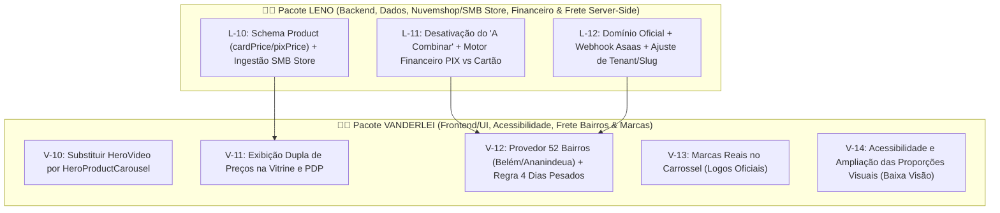

# Guia Mestre de Implementação — Desafios Continental E-Commerce (Leno & Vanderlei)

> **Documento Operacional e Roteiro de Trabalho para a Dupla de Desenvolvedores**  
> **Modelos Recomendados:** Gemini 3.8 Flash (High) / Gemini 4 Argon (High)  
> **Ambiente Base:** Node.js 22+, PostgreSQL 16 (Neon / Prisma), Next.js 16 (App Router), TailwindCSS  
> **Diretriz Mandatória:** Não refatorar código alheio, respeitar isolamento de tenant, integridade transacional e as regras em `AGENTS.md`.

---

## 📌 1. Visão Geral e Arquitetura da Divisão de Trabalho

Seguindo a convenção oficial do projeto (`trabalho_em_dupla/TAREFAS_E_STATUS_DOS_DESENVOLVEDORES.md`), as responsabilidades estão divididas para garantir paralelismo sem conflitos:



| ID Tarefa | Desenvolvedor | Escopo Principal | Arquivos Chave |
| :--- | :--- | :--- | :--- |
| **L-10** | **Leno** | Preços Duplos (Cartão/PIX) & Ingestão SMB Store | `prisma/schema.prisma`, `lib/integrations/nuvemshop-product-ingestion.ts` |
| **L-11** | **Leno** | Fim do "A Combinar" & Bloqueio Server-Side | `lib/freight/shipping-mode.ts`, `services/freight/orchestrator.service.ts`, `services/payment/capabilities.service.ts` |
| **L-12** | **Leno** | Domínios, Webhook Asaas e Normalização de Host/Slug | `lib/tenant.ts`, `app/api/webhooks/asaas/route.ts`, `.env` |
| **V-10** | **Vanderlei** | Carrossel Hero (Destaques e Preços) | `components/home/HeroCarousel.tsx`, `components/home/HomeClient.tsx` |
| **V-11** | **Vanderlei** | Apresentação Visual Dupla de Preços (Cartão + PIX) | `components/home/HomeClient.tsx`, `components/checkout/CheckoutForm.tsx` |
| **V-12** | **Vanderlei** | Tabela 52 Bairros (Belém/Ananindeua) + 4 Dias Pesados | `lib/freight/belem-ananindeua-neighborhoods.ts`, `services/freight/providers/custom-table.provider.ts`, `lib/freight/destination.ts` |
| **V-13** | **Vanderlei** | Marcas Reais no Carrossel | `public/brands/`, `components/catalog/BrandMinimalistCarousel.tsx`, `scripts/seed-catalog-filters.ts` |
| **V-14** | **Vanderlei** | Tipografia & Proporções Ampliadas (Baixa Visão) | `app/globals.css`, `tailwind.config.ts`, `components/home/HomeClient.tsx`, `components/Header.tsx` |

---

## 👨‍💻 PARTE 1 — PLANO DE EXECUÇÃO: LENO (BACKEND & DADOS)

### Tarefa L-10: Preços Duplos (Cartão em Destaque vs. PIX) e Ingestão SMB Store (Desafio 2)

#### 1. Contexto & Problema
Atualmente, em `lib/integrations/nuvemshop-product-ingestion.ts`, a ingestão pega o primeiro valor disponível (`remote.promotional_price || remote.price || 0`) e grava em um único campo `Product.price`. No documento de requisitos, foi solicitado:
- **Preço Cartão (destaque principal):** Valor padrão de venda parcelada ou à vista no cartão.
- **Preço PIX (menor destaque):** Valor promocional à vista.
- Importar esses valores diretamente da SMB Store (Nuvemshop).

#### 2. Alteração no Banco de Dados (`prisma/schema.prisma`)
1. No model `Loja`:
   ```prisma
   pixDiscountPct          Decimal              @default(5.00) @db.Decimal(5, 2) // % de desconto caso o produto não tenha promotional_price na SMB Store
   heroSlides              Json?                // Array de artes e links do Carrossel Hero
   ```
2. No model `Product`:
   ```prisma
   price               Decimal           @db.Decimal(10, 2) // Preço Base / Cartão (em destaque)
   pixPrice            Decimal?          @db.Decimal(10, 2) // Preço no PIX à vista (secundário)
   isFeaturedHero      Boolean           @default(false)    // Indica se deve ir para o carrossel hero
   heroBannerUrl       String?                              // Imagem personalizada de banner hero
   ```
3. Executar migration e regenerate:
   ```powershell
   npx prisma db push # ou npx prisma migrate dev --name add_pix_price_and_hero_slides
   npx prisma generate
   ```

#### 3. Alteração no Ingestor (`lib/integrations/nuvemshop-product-ingestion.ts`)
1. Atualizar `nuvemshopCanonicalProductSchema` para capturar `brand` e os preços variantes:
   ```ts
   brand: z.string().nullable().optional(),
   ```
2. Implementar a lógica determinística de resolução de preços:
   ```ts
   export function resolveNuvemshopDualPrices(
     remote: NuvemshopCanonicalProduct,
     storePixDiscountPct = 5
   ): { cardPrice: number; pixPrice: number } {
     const baseRegular = parseFloat(String(remote.price || 0));
     const basePromo = parseFloat(String(remote.promotional_price || 0));

     const regularCandidates = remote.variants
       .map(v => parseFloat(String(v.price || baseRegular || 0)))
       .filter(p => Number.isFinite(p) && p > 0);

     const promoCandidates = remote.variants
       .map(v => parseFloat(String(v.promotional_price || basePromo || 0)))
       .filter(p => Number.isFinite(p) && p > 0);

     const lowestRegular = regularCandidates.length > 0
       ? Math.min(...regularCandidates)
       : (Number.isFinite(baseRegular) && baseRegular > 0 ? baseRegular : 0);

     const lowestPromo = promoCandidates.length > 0
       ? Math.min(...promoCandidates)
       : (Number.isFinite(basePromo) && basePromo > 0 ? basePromo : 0);

     // Caso 1: A Nuvemshop enviou ambos os preços e promo < regular
     if (lowestRegular > 0 && lowestPromo > 0 && lowestPromo < lowestRegular) {
       return {
         cardPrice: Number(lowestRegular.toFixed(2)),
         pixPrice: Number(lowestPromo.toFixed(2)),
       };
     }

     // Caso 2: Apenas um preço veio preenchido -> usa como Cartão e deriva PIX pelo desconto da Loja
     const effectiveCardPrice = lowestRegular > 0 ? lowestRegular : lowestPromo;
     if (effectiveCardPrice <= 0) return { cardPrice: 0, pixPrice: 0 };

     const factor = (100 - Math.min(99, Math.max(0, storePixDiscountPct))) / 100;
     const computedPixPrice = Math.round(effectiveCardPrice * factor * 100) / 100;

     return {
       cardPrice: Number(effectiveCardPrice.toFixed(2)),
       pixPrice: Number(computedPixPrice.toFixed(2)),
     };
   }
   ```
3. Gravar `price: new Prisma.Decimal(cardPrice.toFixed(2))` e `pixPrice: new Prisma.Decimal(pixPrice.toFixed(2))` nas mutações do Prisma.

#### 4. Motor Financeiro Server-Side (`services/payment/financial-plan.service.ts`)
- No cálculo do subtotal para o meio `PIX`, utilizar a soma autoritativa de `pixPrice ?? price` de cada item do pedido, enquanto para `CREDIT_CARD` e `BOLETO` utiliza-se `price`.

---

### Tarefa L-11: Fim do "Combinar com a Loja" e Regras de Frete no Servidor (Desafio 3 - Backend)

#### 1. Contexto & Problema
O lojista determinou expressamente:
- **Não permitir a opção de "combinar com a loja"** (nem frete via WhatsApp nem pagamento manual via WhatsApp). O cliente deve fechar 100% da compra na plataforma.
- Anteriormente, produtos sem peso/dimensões eram rotulados como `WHATSAPP_ONLY`, disparando a Regra de Contágio do carrinho e bloqueando a cotação automática.

#### 2. Alterações
1. Em `lib/freight/shipping-mode.ts`:
   - Atualizar `classifyProductShippingMode`: produtos sem medidas explícitas na SMB Store não devem mais forçar `WHATSAPP_ONLY`. Recebem fallback seguro oficial dos Correios (`300g, 16x11x4 cm`) e modo `AUTOMATIC`.
   - Adicionar regra de identificação de itens pesados:
     ```ts
     export function isHeavyOrLargeProduct(p: ProductDimensionsLike): boolean {
       if (typeof p.weightInGrams === 'number' && p.weightInGrams >= 15000) return true;
       const sum = (p.lengthCm ?? 16) + (p.widthCm ?? 11) + (p.heightCm ?? 4);
       if (sum > 120) return true;
       const text = `${p.name} ${p.description || ''}`;
       return /\b(EXTRATORA|COMPRESSOR|LAVADORA|ASPIRADOR INDUSTRIAL|POLITRIZ|20L|20 LITROS|50L)\b/i.test(text);
     }
     ```
2. Em `services/freight/orchestrator.service.ts`:
   - Remover as linhas de contágio forçado (`deliveryType = 'NONE'`).
   - Bloquear `NoneOptionProvider` quando `loja.enableNoFreight === false`.
3. Em `services/payment/capabilities.service.ts`:
   - Desativar `WHATSAPP_PIX` garantindo que apenas gateways automatizados (`PIX`, `CREDIT_CARD`, `BOLETO`) sejam liberados.

---

### Tarefa L-12: Domínios, Webhook Asaas e Ajustes de Tenant/Slug (Desafio 6)

#### 1. Resolução de Domínio e Slug (`lib/tenant.ts`)
- O slug da loja (`continental-prototipo` ou `continental-estetica`) não deve ser alterado com pontos.
- Quem assume o domínio final é o campo `Loja.customDomain` (ex: `continentalestetica.com.br`).
- Em `lib/tenant.ts`:
  1. Corrigir a captura de subdomínio para ignorar o host `www`:
     ```ts
     if (cleanHost.endsWith(`.${platformDomain}`)) {
       const slug = cleanHost.replace(`.${platformDomain}`, "");
       if (slug && slug !== "www") {
         const loja = await getCachedLojaBySlug(slug);
         if (loja) return loja as TenantContext | null;
       }
     }
     ```
  2. Ajustar `getCachedLojaBySlugOrDomain` para aceitar correspondência com ou sem `www.`.

#### 2. Procedimento de Webhook no Asaas
1. No painel do Asaas:
   - Configurar URL: `https://<DOMINIO_OFICIAL>/api/webhooks/asaas`
   - Token de Autenticação: O mesmo de `ASAAS_WEBHOOK_TOKEN` no `.env`.
   - Eventos: `PAYMENT_RECEIVED`, `PAYMENT_CONFIRMED`, `PAYMENT_OVERDUE`, `PAYMENT_REFUNDED`.
2. No ambiente de produção:
   - Declarar `PAYMENT_WORKER_ENABLED="true"` para que o endpoint aceite os eventos e persista na fila `PaymentInbox`.

---

## 🎨 PARTE 2 — PLANO DE EXECUÇÃO: VANDERLEI (FRONTEND & UI)

### Tarefa V-10: Substituição da Hero por Carrossel de Produtos em Destaque (Desafio 1)

#### 1. Criar `components/home/HeroCarousel.tsx`
Substitui o antigo `HeroVideo.tsx`.
- Componente cliente (`"use client"`).
- Apresenta slides rotativos (transição suave de fade/slide com pausa em hover/focus).
- Cada slide exibe:
  - Arte enviada pelo dono da loja (ou fallback de imagem do produto de alta resolução).
  - Título do produto com badge *"Destaque Continental"*.
  - **Bloco de Preço Duplo:** Preço no Cartão em tamanho gigante e Preço no PIX em destaque secundário.
  - Botão de Ação: `"Comprar Agora"` (abre modal ou adiciona ao carrinho) e botão secundário `"Ver Catálogo"`.
  - Navegação por setas laterais grandes e dots inferiores.

#### 2. Integrar em `components/home/HomeClient.tsx`
- Substituir a importação e uso de `<HeroVideo />` por:
  ```tsx
  <HeroCarousel
    products={initialProducts.filter(p => (p as any).isFeaturedHero || p.price > 0).slice(0, 5)}
    lojaInfo={lojaInfo}
    onSelectProduct={openProduct}
    onBuyProduct={handleBuy}
  />
  ```

---

### Tarefa V-11: Exibição Dupla de Preços na Vitrine e PDP (Desafio 2 - UI)

#### 1. Modificar os Cards do Catálogo em `HomeClient.tsx`
Substituir o bloco de preço único por:
```tsx
<div className="flex flex-col mt-auto pt-4 border-t border-catalog-gold/30">
  <span className="text-[11px] uppercase tracking-wider text-catalog-muted font-mono font-medium">
    No Cartão de Crédito
  </span>
  <span className="text-2xl sm:text-3xl font-bold text-catalog-text tracking-tight">
    {catalogCurrency.format(prod.price)}
  </span>
  <span className="text-sm font-semibold text-emerald-400 mt-0.5">
    ou {catalogCurrency.format(prod.pixPrice ?? prod.price)} no PIX
  </span>
</div>
```

#### 2. Modificar a Página do Produto (PDP) em `HomeClient.tsx`
```tsx
<div className="pt-4 flex flex-col gap-1 border-b border-catalog-gold/30 pb-6">
  <span className="text-xs uppercase tracking-widest text-catalog-muted font-mono font-bold">
    Preço no Cartão
  </span>
  <span className="text-4xl sm:text-5xl md:text-6xl font-bold text-catalog-text drop-shadow-md whitespace-nowrap">
    {catalogCurrency.format(selectedProduct.price)}
  </span>
  <span className="text-lg sm:text-xl font-bold text-emerald-400 mt-1 flex items-center gap-2">
    <span>À vista no PIX:</span>
    <span className="underline decoration-emerald-500/50">{catalogCurrency.format(selectedProduct.pixPrice ?? selectedProduct.price)}</span>
  </span>
</div>
```

---

### Tarefa V-12: Sistema de Fretes por Bairros (Belém e Ananindeua) + Regra de 4 Dias (Desafio 3 - Frete)

#### 1. Catálogo Canônico dos 52 Bairros (`lib/freight/belem-ananindeua-neighborhoods.ts`)
Criar o módulo com a tabela oficial de tarifas:

```ts
export interface NeighborhoodRate {
  name: string;
  aliases: string[];
  price: number;
}

export const BELEM_ANANINDEUA_RATES: NeighborhoodRate[] = [
  // R$ 10,00
  { name: 'Cidade Nova', aliases: ['cidade nova', 'cidade nova i', 'cidade nova ii', 'cidade nova iii', 'cidade nova iv', 'cidade nova v', 'cidade nova vi', 'cidade nova vii', 'cidade nova viii'], price: 10 },
  { name: 'Guajará', aliases: ['guajara', 'guajara i', 'guajara ii'], price: 10 },
  { name: 'Paar', aliases: ['paar'], price: 10 },

  // R$ 15,00
  { name: 'Curuçambá', aliases: ['curucamba', 'curucamba'], price: 15 },
  { name: 'Icuí / 40 Horas', aliases: ['icui', 'icui-guajara', '40 horas', 'quarenta horas'], price: 15 },
  { name: 'Maguari', aliases: ['maguari', 'caju'], price: 15 },
  { name: 'Providência', aliases: ['providencia', 'val-de-cans providencia'], price: 15 },

  // R$ 20,00
  { name: 'Ananindeua Centro', aliases: ['ananindeua centro', 'centro ananindeua'], price: 20 },
  { name: 'Atalaia', aliases: ['atalaia'], price: 20 },
  { name: 'Cabanagem', aliases: ['cabanagem'], price: 20 },
  { name: 'Castanheira', aliases: ['castanheira'], price: 20 },
  { name: 'Distrito Industrial', aliases: ['distrito industrial'], price: 20 },
  { name: 'Guanabara', aliases: ['guanabara'], price: 20 },
  { name: 'Icuí Laranjeira', aliases: ['icui laranjeira', 'laranjeira'], price: 20 },
  { name: 'Jaderlândia', aliases: ['jaderlandia', 'jaderlandia i', 'jaderlandia ii'], price: 20 },
  { name: 'Jiboia Branca', aliases: ['jiboia branca'], price: 20 },
  { name: 'Mangueirão', aliases: ['mangueirao'], price: 20 },
  { name: 'Marambaia', aliases: ['marambaia', 'nova marambaia'], price: 20 },
  { name: 'Una', aliases: ['una'], price: 20 },

  // R$ 25,00
  { name: 'Águas Brancas', aliases: ['aguas brancas'], price: 25 },
  { name: 'Águas Lindas', aliases: ['aguas lindas'], price: 25 },
  { name: 'Benguí', aliases: ['bengui'], price: 25 },
  { name: 'Júlia Seffer', aliases: ['julia sefer', 'julia seffer'], price: 25 },
  { name: 'Parque Verde', aliases: ['parque verde'], price: 25 },

  // R$ 30,00
  { name: 'Aeroporto', aliases: ['aeroporto'], price: 30 },
  { name: 'Aurá', aliases: ['aura'], price: 30 },
  { name: 'Barreiro', aliases: ['barreiro'], price: 30 },
  { name: 'Curió-Utinga', aliases: ['curio-utinga', 'curio utinga', 'curio', 'utinga'], price: 30 },
  { name: 'Marco', aliases: ['marco'], price: 30 },
  { name: 'Marituba', aliases: ['marituba'], price: 30 },
  { name: 'Pedreira', aliases: ['pedreira'], price: 30 },
  { name: 'Sacramenta', aliases: ['sacramenta'], price: 30 },
  { name: 'Souza', aliases: ['souza'], price: 30 },
  { name: 'Tapanã', aliases: ['tapana'], price: 30 },
  { name: 'Telégrafo', aliases: ['telegrafo', 'telegrafo sem fio'], price: 30 },
  { name: 'Tenoné', aliases: ['tenone'], price: 30 },
  { name: 'Val-de-Cães', aliases: ['val-de-caes', 'val-de-cans'], price: 30 },

  // R$ 35,00
  { name: 'Campina', aliases: ['campina'], price: 35 },
  { name: 'Cidade Velha', aliases: ['cidade velha'], price: 35 },
  { name: 'Fátima', aliases: ['fatima'], price: 35 },
  { name: 'Icoaraci', aliases: ['icoaraci', 'icooraci', 'cruzeiro', 'ponta grossa'], price: 35 },
  { name: 'Nazaré', aliases: ['nazare'], price: 35 },
  { name: 'Pratinha', aliases: ['pratinha', 'pratinha i', 'pratinha ii'], price: 35 },
  { name: 'Reduto', aliases: ['reduto'], price: 35 },
  { name: 'São Brás', aliases: ['sao bras'], price: 35 },
  { name: 'Umarizal', aliases: ['umarizal'], price: 35 },

  // R$ 40,00
  { name: 'Batista Campos', aliases: ['batista campos'], price: 40 },
  { name: 'Canudos', aliases: ['canudos'], price: 40 },
  { name: 'Condor', aliases: ['condor'], price: 40 },
  { name: 'Cremação', aliases: ['cremacao'], price: 40 },
  { name: 'Guamá', aliases: ['guama'], price: 40 },
  { name: 'Jurunas', aliases: ['jurunas'], price: 40 },
  { name: 'Terra Firme', aliases: ['terra firme', 'montese'], price: 40 },

  // R$ 50,00
  { name: 'Outeiro', aliases: ['outeiro', 'agua boa', 'brasilia', 'sao joao do outeiro'], price: 50 },
];
```

#### 2. Integrar em `CustomTableProvider` (`services/freight/providers/custom-table.provider.ts`)
- Reconhece se o município do CEP é Belém (`1501402`), Ananindeua (`1500800`) ou Marituba (`1504422`).
- Detecta o bairro via `request.destination.neighborhood`.
- Caso haja item pesado/grande no carrinho:
  - `serviceName = "Entrega Própria (Veículo da Loja) - " + rate.name`
  - `deliveryTimeInDays = 4` (prazo especial de até 4 dias úteis conforme especificação).
- Caso sejam itens padrão:
  - `serviceName = "Entregador Local - " + rate.name`
  - `deliveryTimeInDays = 1` (1 dia útil).

#### 3. Ajuste no Checkout (`components/checkout/CheckoutForm.tsx`)
- Remover abas e seleções de "Frete a Combinar" e "Combinar via WhatsApp".
- Se o CEP de Belém/Ananindeua retornar sem bairro no ViaCEP, disponibilizar um dropdown acessível com os 52 bairros para que o cliente selecione seu bairro e a taxa seja calculada na hora.

---

### Tarefa V-13: Marcas Reais no Carrossel (Desafio 4)

1. **Substituição de Ativos:**
   - Em `public/brands/`, substituir os SVGs de texto puro pelos arquivos vetoriais ou logos oficiais:
     - `vonixx.svg`, `easytech.svg`, `cadillac.svg`, `lincoln.svg`, `kers.svg`, `nobrecar.svg`, `zacs.svg`, `ipc.svg`, `karcher.svg`, `wap.svg`, `autoamerica.svg`, `meguiars.svg`, `nasiol.svg`, `protelim.svg`, `sandet.svg`, `sigma-tools.svg`, `soft99.svg`, `sonax.svg`.
   - Renomear `sigmatools.svg` para `sigma-tools.svg` para casar com o slug cadastrado no banco.
2. **Atualizar `scripts/seed-catalog-filters.ts`:**
   - Adicionar todas as marcas reais da loja no array `BRANDS` e rodar a sincronização.
3. **Ajuste em `BrandMinimalistCarousel.tsx`:**
   - Aumentar o container visual das marcas de `h-12` para `h-16 sm:h-20` para melhor nitidez e impacto visual.

---

### Tarefa V-14: Acessibilidade e Aumento das Proporções Visuais para Baixa Visão (Desafio 5)

1. **Escala Base em `app/globals.css`:**
   ```css
   html {
     font-size: 106.25%; /* 17px no mobile */
   }
   @media (min-width: 768px) {
     html {
       font-size: 112.5%; /* 18px no desktop */
     }
   }
   ```
   *Efeito:* Eleva de forma harmônica todos os elementos que utilizam `rem` (Tailwind) sem quebrar o layout.
2. **Contraste em `tailwind.config.ts`:**
   - Elevar `catalog.muted` de `#94A3B8` para `#CBD5E1` (Slate-300).
3. **Componentes:**
   - Substituir tags `text-[10px]` por `text-xs sm:text-sm font-semibold`.
   - Ampliar a altura mínima dos cards em `HomeClient.tsx` para `min-h-[530px]`.
   - Ampliar botões de adicionar ao carrinho e links do Header (`Header.tsx`).

---

## 🚀 PARTE 3 — PROMPTS PRONTOS PARA EXECUÇÃO NO GEMINI 3.8 FLASH (HIGH)

Copie e cole os blocos abaixo para cada desenvolvedor executar sua respectiva etapa:

### Prompt 1 (Para LENO - Tarefa L-10):
```text
Atue como o desenvolvedor LENO (Backend & Dados) no projeto Sistema-E-Commerce.
Sua missão é implementar a Tarefa L-10 descrita em GUIA_IMPLEMENTACAO_LENO_VANDERLEI.md:
1. Altere prisma/schema.prisma adicionando pixDiscountPct em Loja, e pixPrice, isFeaturedHero e heroBannerUrl em Product.
2. Atualize lib/integrations/nuvemshop-product-ingestion.ts com a função resolveNuvemshopDualPrices para extrair cardPrice (price) e pixPrice (promotional_price ou via percentual) de produtos da Nuvemshop.
3. Garanta que app/page.tsx e product.service.ts repassem pixPrice para o frontend.
4. Ajuste services/payment/financial-plan.service.ts para usar pixPrice no cálculo do subtotal para método PIX.
Execute npx tsc --noEmit e npx vitest run tests/unit/nuvemshop-product-ingestion.test.ts ao final para validar.
Não altere componentes de frontend.
```

### Prompt 2 (Para LENO - Tarefas L-11 e L-12):
```text
Atue como o desenvolvedor LENO (Backend & Dados) no projeto Sistema-E-Commerce.
Sua missão é implementar as Tarefas L-11 e L-12 descritas em GUIA_IMPLEMENTACAO_LENO_VANDERLEI.md:
1. Em lib/freight/shipping-mode.ts, remova a atribuição de WHATSAPP_ONLY para produtos sem medidas na SMB Store, aplicando as dimensões mínimas oficiais dos Correios (300g, 16x11x4 cm) e implementando a detecção de itens pesados (isHeavyOrLargeProduct).
2. Em services/freight/orchestrator.service.ts e services/payment/capabilities.service.ts, desative as opções de frete a combinar e pagamento via WhatsApp.
3. Em lib/tenant.ts, ajuste a resolução de hosts para ignorar subdomínio 'www' na busca de slugs e faça getCachedLojaBySlugOrDomain tolerar correspondências com ou sem 'www.'.
Execute npx tsc --noEmit e npx vitest run tests/unit/tenant-resolver.test.ts tests/unit/shipping-mode.test.ts.
```

### Prompt 3 (Para VANDERLEI - Tarefas V-10 e V-11):
```text
Atue como o desenvolvedor VANDERLEI (Frontend & UI) no projeto Sistema-E-Commerce.
Sua missão é implementar as Tarefas V-10 e V-11 descritas em GUIA_IMPLEMENTACAO_LENO_VANDERLEI.md:
1. Crie components/home/HeroCarousel.tsx substituindo HeroVideo.tsx, exibindo artes de produtos em destaque, títulos grandes e bloco duplo de preços (Cartão em destaque principal e PIX secundário), com CTAs claros de compra e navegação acessível.
2. Em components/home/HomeClient.tsx, troque HeroVideo pelo HeroCarousel e atualize a exibição de preços nos cards da vitrine e na página de detalhes do produto para exibir tanto o valor do Cartão quanto o valor no PIX.
Execute npx tsc --noEmit e verifique se a compilação passa com 0 erros.
```

### Prompt 4 (Para VANDERLEI - Tarefas V-12, V-13 e V-14):
```text
Atue como o desenvolvedor VANDERLEI (Frontend & UI) no projeto Sistema-E-Commerce.
Sua missão é implementar as Tarefas V-12, V-13 e V-14 descritas em GUIA_IMPLEMENTACAO_LENO_VANDERLEI.md:
1. Crie lib/freight/belem-ananindeua-neighborhoods.ts com a tabela completa dos 52 bairros de Belém e Ananindeua.
2. Atualize lib/freight/destination.ts para reter o neighborhood retornado pelo ViaCEP.
3. Em services/freight/providers/custom-table.provider.ts, integre a consulta aos 52 bairros com prazo de 1 dia para encomendas normais e 4 dias úteis para itens pesados (veículo da loja).
4. No CheckoutForm.tsx e ProductFreightCalculator.tsx, remova opções de "Frete a Combinar" e adicione seletor de bairro quando o CEP de Belém/Ananindeua for geral.
5. Em app/globals.css e tailwind.config.ts, amplie a escala tipográfica base e ajuste o contraste para clientes com baixa visão.
6. Ajuste public/brands/ e BrandMinimalistCarousel.tsx com as logos e dimensões corretas.
Execute npx tsc --noEmit e npm run test:unit ao final.
```

---

## 🛡️ Checklist de Verificação & Critérios de Aceite

- [ ] `npx tsc --noEmit` executado sem nenhum erro de tipagem.
- [ ] `npm run test:unit` rodando 100% verde (106 arquivos de testes aprovados).
- [ ] Vitrine inicial renderiza o **Carrossel Hero** com imagens e preços duplos.
- [ ] Todos os cards exibem **Preço no Cartão** (destaque) e **Preço no PIX** (secundário).
- [ ] Cotação com CEP de Belém/Ananindeua retorna o nome e o valor exato do bairro conforme a tabela oficial.
- [ ] Produtos pesados adicionados ao carrinho geram prazo de entrega de até 4 dias úteis para Belém/Ananindeua.
- [ ] Remoção completa de "A Combinar via WhatsApp" (todo checkout conclui na plataforma).
- [ ] Carrossel de marcas apresenta logos reais das marcas automotivas da loja.
- [ ] Textos e botões estão confortavelmente legíveis em monitores e dispositivos móveis.
