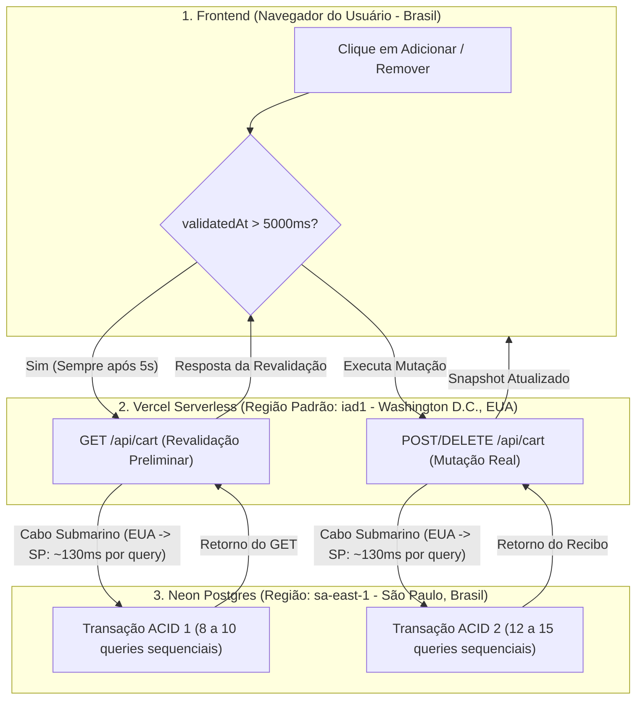
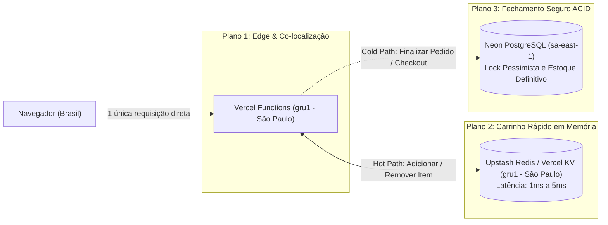
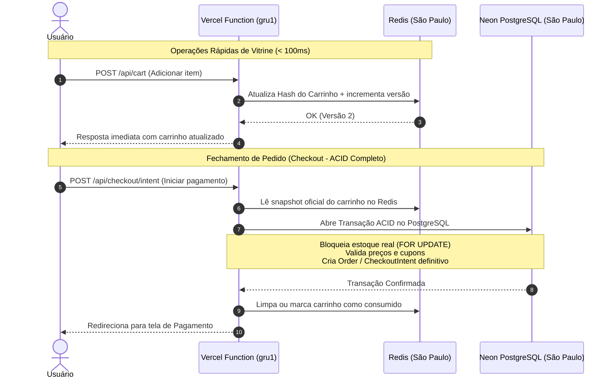

# Arquitetura de Evolução: Camadas de Cache e Otimização de Performance do Carrinho

> **Documento:** Proposta Arquitetural de Alta Performance para o E-Commerce  
> **Escopo:** Redução drástica da latência do Carrinho (de ~5s para < 300ms)  
> **Status:** Planejamento / Futura Evolução  
> **Diretório:** `diversos/FFUTURAS_EVOLUCOES/Camadas_de_cache/`  
> **Data:** Novembro de 2026  

---

## 1. Contexto e Diagnóstico Real (Vercel + Neon São Paulo)

Mesmo operando com o banco de dados Neon configurado na região de **São Paulo (`sa-east-1`)** e hospedagem na **Vercel**, a latência observada no carrinho atinge a faixa de **4,5 a 5 segundos** tanto na adição quanto na remoção de produtos.

A investigação profunda revelou que esse comportamento é resultado de uma sobreposição de 3 gargalos de arquitetura:



### 1.1. O Efeito "Ping-Pong Transcontinental" (Vercel `iad1` $\leftrightarrow$ Neon `sa-east-1`)
* Por padrão, a Vercel instancia funções serverless na região **`iad1` (Washington D.C., EUA)**, a menos que seja explicitamente configurado no `vercel.json` o apontamento para São Paulo (`gru1`).
* Se a função executa nos EUA e o banco Neon está em São Paulo, **cada consulta SQL individual precisa viajar dos EUA para o Brasil e voltar**.
* Como o Prisma executa transações interativas com dezenas de `await tx...` sequenciais (advisory lock, verificação de tenant, checagem de concorrência, log de auditoria, update e releitura), ocorrem **entre 20 e 25 viagens transcontinentais** somando a leitura e a escrita, acumulando ~3 segundos puramente de trânsito de fibra óptica.

### 1.2. O "Pedágio de Segurança" no Frontend (`store/cart.store.ts`)
* O cliente possui a condição:
  ```typescript
  if (!unresolved && (get().loadState !== 'ready' || Date.now() - validatedAt > 5000)) {
    await read(current, signal);
  }
  ```
* Se o usuário ficar mais de 5 segundos na página antes de interagir com o carrinho, qualquer clique em "REMOVER" ou "ADICIONAR" **pausa e força primeiro um `GET /api/cart` completo**, e só depois envia a requisição de alteração real. O usuário aguarda **duas transações completas** consecutivas.

### 1.3. Custo da Consistência Estrita em Disco (ACID Imediato)
* Todo e qualquer item colocado ou retirado do carrinho disputa imediatamente travas pessimistas no banco relacional (`SELECT pg_advisory_xact_lock(...)`, `SELECT ... FOR UPDATE`), gerando escrita imediata em log de transação (WAL/disco) e registro de auditoria (`AuditLog`), modelo típico de sistemas bancários mas altamente custoso para navegação de vitrine.

---

## 2. Visão da Arquitetura Alvo (Padrão AliExpress / E-Commerce Global)

Para atingir respostas de **sub-200ms** mantendo isolamento absoluto entre tenants e proteção financeira total, a arquitetura é reestruturada em **três planos de execução**:



### Princípios da Nova Arquitetura
1. **Co-localização Geográfica Estrita (`gru1`):** A execução do código (Vercel) e o armazenamento de dados (Redis + Postgres) devem residir na mesma zona física (São Paulo).
2. **Separação entre "Navegação de Carrinho" e "Compromisso de Compra":**
   * *Carrinho Ativo:* Armazenamento em memória volátil/rápida (Redis), sem travas pessimistas pesadas de linha no banco principal.
   * *Checkout / Pagamento:* Transação ACID estrita com validação de estoque e trava transacional no PostgreSQL.
3. **Frontend Otimizado (Single-Flight Mutation):** Eliminação da requisição dupla preliminar; a mutação envia a versão conhecida e o servidor resolve conflitos de forma idempotente em um único salto de rede.

---

## 3. Detalhamento dos Componentes da Arquitetura

### 3.1. Camada de Cache em Memória: Redis para o Carrinho Ativo

O carrinho ativo deixa de depender de escrita imediata no PostgreSQL e passa a ser operado em uma instância **Redis (Upstash / Vercel KV)** regionalizada em São Paulo.

#### Estrutura de Chave e Dados no Redis
```text
Chave: cart:{lojaID}:{userID}
Tipo: Hash ou JSON String
TTL: 2.592.000 segundos (30 dias de expiração automática)
```

**Payload do Carrinho no Redis:**
```json
{
  "cartId": "c6a7e2b1-4f8a-493e-9b21-419b4e87d123",
  "lojaID": "loja-matriz-01",
  "userID": "usr_998877",
  "version": 4,
  "updatedAt": 1793879200000,
  "items": [
    {
      "variantID": "var_lavadora_pw_c04",
      "productID": "prod_lavadora_ipc",
      "quantity": 1,
      "price": 559.99,
      "productName": "LAVADORA DE ALTA PRESSÃO PW-C04 IPC",
      "imageUrl": "https://cdn.exemplo.com/pw-c04.jpg"
    }
  ]
}
```

#### Vantagens Operacionais:
* Uma operação de `HSET`, `HGET` ou `HDEL` no Redis leva **< 2 milissegundos**.
* Resolução atômica de concorrência com **scripts Lua** no Redis, garantindo incrementos sem condição de corrida sem necessitar de `pg_advisory_xact_lock` no PostgreSQL.
* Desafoga completamente o pool de conexões do Neon, preservando recursos do banco para relatórios, catálogo e fechamento de vendas.

---

### 3.2. Estratégia de Transição: Como o PostgreSQL é Atualizado?

O maior dilema ao utilizar cache é: *quando e como garantir que o banco de dados oficial (PostgreSQL) tenha os dados do carrinho?*

Adota-se uma abordagem híbrida (**Write-Through no Checkout + Sincronização Assíncrona no Abandono**):



1. **Durante a Adição e Remoção de Itens:** O Redis é a fonte da verdade para o estado imediato do usuário.
2. **Na Abertura do Checkout:** O backend lê o estado consolidado do Redis e descarrega uma única transação atômica no PostgreSQL. Nesse instante, valida-se o estoque real com `SELECT ... FOR UPDATE` e gera-se a reserva formal da compra.
3. **Se um item esgotar entre a adição e o checkout:** O checkout informa de maneira elegante: *"O produto X acabou de esgotar por outro comprador"*, exatamente como fazem o AliExpress e a Amazon.

---

### 3.3. Otimização do Frontend (`store/cart.store.ts`)

A lógica do cliente é refinada para eliminar esperas desnecessárias:

1. **Eliminação do `GET` Preliminar Obrigatório:**
   * O cliente envia a mutação imediatamente (`POST`, `PATCH` ou `DELETE`) contendo `cartId` e a última versão que ele conhece (`expectedVersion`).
   * Se o servidor detectar uma divergência de versão (conflito raro de abas paralelas), o próprio servidor retorna `HTTP 409 Conflict` com o snapshot mais recente já embutido na resposta do erro.
   * Isso reduz o tráfego de **2 requisições para apenas 1 requisição direta**.

2. **Ajuste da Janela de Revalidação (`maxAgeMs`):**
   * O gatilho de 5 segundos (`Date.now() - validatedAt > 5000`) é expandido para uma janela de **60 a 120 segundos**, ou acionado unicamente quando a aba do navegador recupera o foco (`window onfocus`).

3. **Feedback Visual Imediato no Drawer:**
   * Ao clicar em "REMOVER", o item entra instantaneamente em estado de desvanecimento (*opacity: 0.4*) com um indicador de progresso sutil, sem bloquear a rolagem da tela nem travar outros elementos interativos.

---

### 3.4. Co-localização Vercel (`vercel.json`)

Para eliminar o trajeto EUA $\leftrightarrow$ Brasil, o arquivo de configuração de deploy da Vercel passa a declarar explicitamente a região de execução em São Paulo:

```json
{
  "framework": "nextjs",
  "regions": ["gru1"]
}
```

* **Antes:** Cliente (Brasil) $\rightarrow$ Vercel `iad1` (EUA) $\rightarrow$ Neon `sa-east-1` (São Paulo) $\rightarrow$ Vercel `iad1` (EUA) $\rightarrow$ Cliente (Brasil).
* **Depois:** Cliente (Brasil) $\rightarrow$ Vercel `gru1` (São Paulo) $\rightarrow$ Neon `sa-east-1` (São Paulo) $\rightarrow$ Cliente (Brasil).

---

## 4. Análise de Riscos e Mitigações

| Risco Potencial | Impacto | Mecanismo de Mitigação |
| :--- | :--- | :--- |
| **Queda ou Indisponibilidade do Redis** | Falha nas mutações de carrinho | **Fallback Automático (Graceful Degradation):** Se o cliente Redis falhar ou der timeout de 200ms, o código captura a exceção e delega a operação diretamente para o serviço PostgreSQL legado. |
| **Divergência Multi-Aba (Concorrência)** | Usuário adiciona item no celular e remove no PC | **Versionamento Monotônico no Redis:** Cada escrita no Redis usa script Lua que verifica se `version == expectedVersion`. Em caso de divergência, incrementa e devolve o estado real. |
| **Furo de Estoque na Vitrine** | Cliente adiciona produto com 1 unidade no estoque e outro compra | O estoque **não é reservado no carrinho**, é reservado apenas no checkout. O sistema revalida o estoque com trava ACID no PostgreSQL assim que o usuário clica em fechar a compra. |
| **Isolamento Multi-Tenant** | Risco de um tenant acessar o carrinho de outro | Chaves no Redis obrigatoriamente prefixadas com `cart:{lojaID}:{userID}` e validação rigorosa de token/sessão no header antes de acessar qualquer chave. |

---

## 5. Roteiro de Implementação Sugerido (Fases)

### Fase 1: Otimizações Rápidas de Baixo Risco (*Quick Wins*)
* **Meta:** Reduzir a latência de ~5s para ~1s sem alterar a arquitetura de banco de dados.
* **Ações:**
  1. Configurar `regions: ["gru1"]` na Vercel para co-localizar funções serverless com o Neon em São Paulo.
  2. Ajustar `store/cart.store.ts` para eliminar a checagem prévia obrigatória de 5 segundos, enviando a mutação em chamada única.

### Fase 2: Implantação da Camada de Cache (Redis)
* **Meta:** Reduzir a latência para a faixa de **100ms a 250ms**.
* **Ações:**
  1. Provisionar instância Upstash Redis (ou Vercel KV) na região de São Paulo (`sa-east-1`).
  2. Criar serviço `services/cart-cache.service.ts` com comandos atômicos (`getCart`, `setCartItem`, `removeCartItem`).
  3. Adicionar chave de fallback para o PostgreSQL em caso de falha de conexão com o Redis.

### Fase 3: Desacoplamento da Reserva de Estoque e Checkout
* **Meta:** Alinhar o fluxo de compra à experiência dos maiores e-commerces do mercado.
* **Ações:**
  1. Simplificar a rota `/api/cart` para focar puramente em persistência de itens no cache rápido.
  2. Concentrar todas as travas pessimistas (`locks.acquireCartOwner`, `locks.acquire('product')`) na rota de criação de pedido (`/api/checkout/intent`).

---

## 6. Conclusão

A demora de 5 segundos observada na Vercel não é uma limitação do Next.js nem do hardware do Neon, mas sim o resultado físico da distância entre a função serverless padrão nos EUA (`iad1`) e o banco no Brasil (`sa-east-1`), multiplicada pelo número de queries de uma transação pessimista e pela duplicação de requisições no frontend.

A evolução para uma **arquitetura de cache em memória regionalizada (Redis em `gru1`)** resolve a raiz do problema, proporcionando ao sistema a mesma agilidade e sensação de resposta instantânea observadas em plataformas de escala global como o AliExpress, sem abrir mão da segurança no momento do pagamento.

