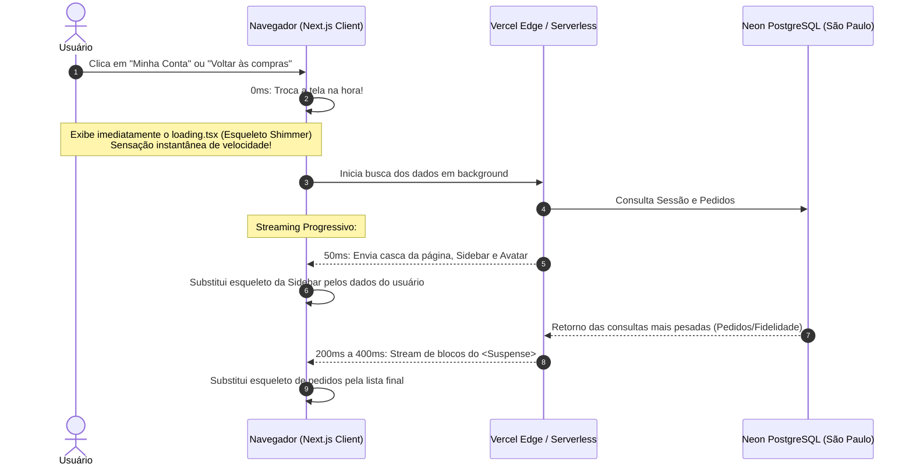

# Arquitetura de Otimização: UI Instantânea com Skeletons (loading.tsx), Streaming com Suspense e Prefetching

> **Documento:** Especificação Técnica de Otimização de Performance e Navegação  
> **Escopo:** Eliminação do congelamento de ~3s na transição entre Catálogo (`/`) e Minha Conta (`/profile`)  
> **Status:** Planejamento Aprovado para Implementação Futura  
> **Diretório:** `diversos/OTIMIZACOES/Abas/ARQUITETURA_INSTANT_SKELETONS_E_STREAMING_SUSPENSE.md`  
> **Data:** Novembro de 2026  

---

## 1. Contexto e Diagnóstico do Gargalo Atual

Atualmente, ao transitar entre o **Catálogo de Produtos (`/`)** e a área de **Minha Conta / Perfil (`/profile`)**, o usuário percebe um atraso de aproximadamente **3 segundos** com a tela totalmente congelada antes da mudança de página.

### Por que isso acontece?
1. **Ausência de `loading.tsx` no App Router:**  
   No Next.js App Router, quando uma rota busca dados no servidor, se a pasta da rota não possuir um arquivo `loading.tsx`, o framework **propositalmente congela a tela atual** até que 100% dos dados da nova página tenham sido gerados pelo servidor. O usuário clica e nada acontece por 3 segundos, dando a sensação de que o botão falhou ou que o sistema travou.
2. **Renderização Forçada no Servidor (`force-dynamic`):**  
   Em [`app/profile/page.tsx`](file:///c:/Diversos/TI/Trabalhos/2026/Sistemas/Projeto/app/profile/page.tsx#L9), a página define `export const dynamic = "force-dynamic"`, exigindo que a Vercel consulte a sessão e a lista completa de pedidos no Neon PostgreSQL a cada transição.
3. **Carga Massiva no Catálogo (`all: true`):**  
   Em [`app/page.tsx`](file:///c:/Diversos/TI/Trabalhos/2026/Sistemas/Projeto/app/page.tsx#L16), o retorno para o catálogo executa `getProducts({ all: true })`, puxando do banco todos os produtos, variantes e marcas existentes de uma só vez antes de liberar a visualização.
4. **Distância Geográfica (Vercel EUA $\leftrightarrow$ Neon São Paulo):**  
   As múltiplas queries sequenciais atravessam cabos submarinos internacionais, acumulando 2 a 3 segundos apenas em trânsito de dados.

---

## 2. Visão da Arquitetura Alvo: Navegação com Resposta em 0ms

A solução adota o padrão de **UI Instantânea com Esqueletos Visuais (*Instant Skeletons*)** e **Streaming com React Suspense**:



---

## 3. Os Três Pilares da Implementação

### Pilar 1: Instant Loading UI com Skeletons (`loading.tsx`)

Criar arquivos `loading.tsx` dedicados que espelham perfeitamente o layout escuro e dourado da aplicação (`#050505`, bordas em `catalog-gold/30` e efeito pulsante `animate-pulse`).

#### 1.1. Esqueleto do Perfil (`app/profile/loading.tsx`)
Renderizado instantaneamente (0ms) ao clicar em "Minha Conta":
* Exibe o botão de retorno em skeleton;
* Exibe o cabeçalho "Minha Conta" com skeleton;
* Exibe a Sidebar com o círculo do avatar pulsando e os 3 botões de abas em skeleton;
* Exibe a área principal com 3 cards de pedidos simulados em cinza escuro cintilante.

#### 1.2. Esqueleto do Catálogo (`app/loading.tsx`)
Renderizado instantaneamente (0ms) ao clicar em "Voltar às compras":
* Exibe o banner principal em skeleton;
* Exibe a barra de categorias/filtros em skeleton;
* Exibe uma grade de 8 cards de produtos com shimmer (imagem, título e preço simulados).

---

### Pilar 2: Streaming SSR com React `<Suspense>` Granular

Em vez de bloquear a página inteira até que a consulta de pedidos `getUserOrders()` responda, o componente de página é decomposto com `<Suspense>`:

```tsx
// Exemplo de estrutura em app/profile/page.tsx
export default async function ProfilePage() {
  const user = await getCurrentUser();
  if (!user) redirect("/login");

  return (
    <div className="min-h-screen bg-[#050505] ...">
      {/* 1. Header e Sidebar carregam imediatamente com os dados do usuário autenticado */}
      <ProfileHeader user={user} />

      <div className="grid grid-cols-1 md:grid-cols-4 gap-8">
        <ProfileSidebar user={user} />

        {/* 2. O conteúdo pesado (pedidos) fica sob Suspense com fallback próprio */}
        <div className="md:col-span-3">
          <Suspense fallback={<OrdersListSkeleton />}>
            <OrdersSection userId={user.id} lojaId={user.lojaID} />
          </Suspense>
        </div>
      </div>
    </div>
  );
}
```

* **Vantagem:** O servidor responde a primeira parte do HTML (TTFB) em **menos de 50 milissegundos**. O usuário já vê seu nome e foto na tela enquanto a lista de pedidos chega via stream do servidor.

---

### Pilar 3: Prefetching Otimizado do `next/link`

Nos componentes de cabeçalho ([`components/layout/Header.tsx`](file:///c:/Diversos/TI/Trabalhos/2026/Sistemas/Projeto/components/layout/Header.tsx)) e no botão de retorno ([`app/profile/page.tsx`](file:///c:/Diversos/TI/Trabalhos/2026/Sistemas/Projeto/app/profile/page.tsx#L30)):

```tsx
<Link 
  href="/profile" 
  prefetch={true} 
  className="..."
>
  Minha Conta
</Link>
```

* Quando o usuário passa o mouse por cima do link (*hover*) ou quando o botão entra na área visível da tela (*viewport*), o Next.js já baixa o pacote da rota em segundo plano.
* Ao clicar de fato, a transição ocorre quase **sem consumo de tempo de rede**.

---

## 4. Blueprint / Código de Referência para Implementação Futura

### Blueprint 1: `app/profile/loading.tsx`
```tsx
export default function ProfileLoading() {
  return (
    <div className="min-h-screen bg-[#050505] text-catalog-text pt-24 md:pt-28 pb-16 px-4 md:px-8">
      <div className="max-w-6xl mx-auto space-y-6">
        {/* Botão Voltar Skeleton */}
        <div className="h-4 w-36 bg-neutral-800 rounded animate-pulse" />

        {/* Header Skeleton */}
        <div className="border-b border-catalog-gold/20 pb-6 space-y-3">
          <div className="h-3 w-48 bg-catalog-gold/20 rounded animate-pulse" />
          <div className="h-8 w-64 bg-neutral-800 rounded animate-pulse" />
          <div className="h-4 w-96 bg-neutral-800/60 rounded animate-pulse" />
        </div>

        {/* Grid: Sidebar + Conteúdo */}
        <div className="grid grid-cols-1 md:grid-cols-4 gap-8">
          {/* Sidebar Skeleton */}
          <div className="md:col-span-1 bg-catalog-card border border-catalog-gold/20 rounded-2xl p-6 h-fit space-y-6">
            <div className="flex flex-col items-center space-y-3">
              <div className="w-20 h-20 rounded-full bg-neutral-800 animate-pulse border border-catalog-gold/30" />
              <div className="h-4 w-32 bg-neutral-800 rounded animate-pulse" />
              <div className="h-3 w-40 bg-neutral-800/60 rounded animate-pulse" />
            </div>
            <div className="space-y-2 pt-2 border-t border-catalog-gold/20">
              <div className="h-10 w-full bg-neutral-800/80 rounded-xl animate-pulse" />
              <div className="h-10 w-full bg-neutral-800/40 rounded-xl animate-pulse" />
              <div className="h-10 w-full bg-neutral-800/40 rounded-xl animate-pulse" />
            </div>
          </div>

          {/* Área Principal Skeleton */}
          <div className="md:col-span-3 space-y-4">
            <div className="h-32 w-full bg-catalog-card border border-catalog-gold/20 rounded-2xl animate-pulse" />
            <div className="h-32 w-full bg-catalog-card border border-catalog-gold/20 rounded-2xl animate-pulse" />
            <div className="h-32 w-full bg-catalog-card border border-catalog-gold/20 rounded-2xl animate-pulse" />
          </div>
        </div>
      </div>
    </div>
  );
}
```

---

### Blueprint 2: `app/loading.tsx` (Catálogo / Homepage)
```tsx
export default function HomeLoading() {
  return (
    <div className="min-h-screen bg-[#050505] text-white pt-20 px-4 md:px-8 max-w-7xl mx-auto space-y-8">
      {/* Hero Banner Skeleton */}
      <div className="w-full h-64 md:h-80 rounded-2xl bg-neutral-900 border border-catalog-gold/20 animate-pulse" />

      {/* Categorias Bar Skeleton */}
      <div className="flex gap-3 overflow-x-auto pb-2">
        {Array.from({ length: 6 }).map((_, i) => (
          <div key={i} className="h-10 w-28 shrink-0 rounded-xl bg-neutral-900 border border-white/5 animate-pulse" />
        ))}
      </div>

      {/* Grid de Produtos Skeleton */}
      <div className="grid grid-cols-2 md:grid-cols-3 lg:grid-cols-4 gap-6">
        {Array.from({ length: 8 }).map((_, i) => (
          <div key={i} className="rounded-2xl bg-neutral-900/80 border border-catalog-gold/20 p-4 space-y-3">
            <div className="w-full aspect-square rounded-xl bg-neutral-800 animate-pulse" />
            <div className="h-4 w-3/4 bg-neutral-800 rounded animate-pulse" />
            <div className="h-3 w-1/2 bg-neutral-800/60 rounded animate-pulse" />
            <div className="h-6 w-1/3 bg-catalog-gold/20 rounded animate-pulse" />
          </div>
        ))}
      </div>
    </div>
  );
}
```

---

## 5. Comparativo de Performance

| Métrica | Situação Atual | Com Skeletons + Suspense + Prefetch |
| :--- | :--- | :--- |
| **Tempo de resposta visual ao clique** | ~3 segundos (tela congelada) | **0 a 50 milissegundos (Instantâneo)** |
| **Feedback ao usuário** | Nenhum (parece travado) | Esqueleto visual cintilante (*Shimmer*) |
| **Tempo até a Sidebar/Header aparecer** | ~3 segundos | **< 100 milissegundos** |
| **Risco de dados obsoletos de sessão** | Baixo | **Zero (autenticação conferida via SSR)** |
| **Cumulative Layout Shift (CLS)** | Alto (salto repentino de tela) | **Zero (o esqueleto reserva o espaço exato)** |

---

## 6. Conclusão

Esta abordagem elimina por completo a percepção de demora de 3 segundos na troca de abas e telas, conferindo ao sistema a mesma fluidez e sofisticação de plataformas globais (como Shopify Plus e Mercado Livre), mantendo o isolamento multi-tenant e a segurança estrita de sessão do Next.js.

