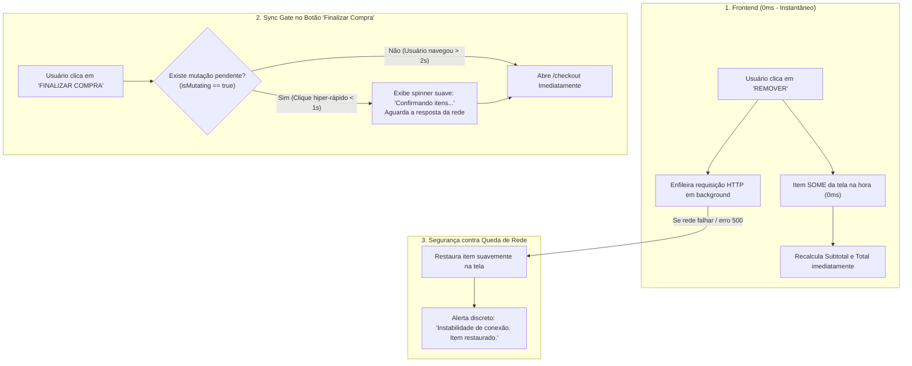
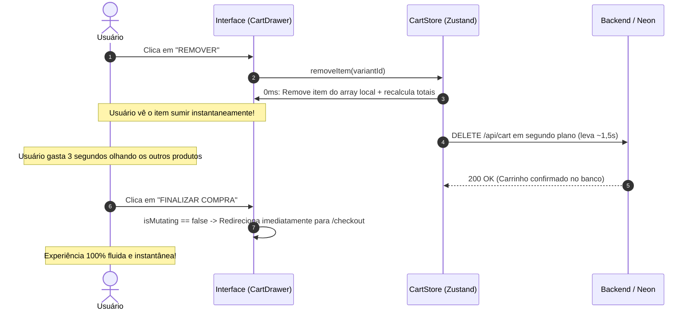
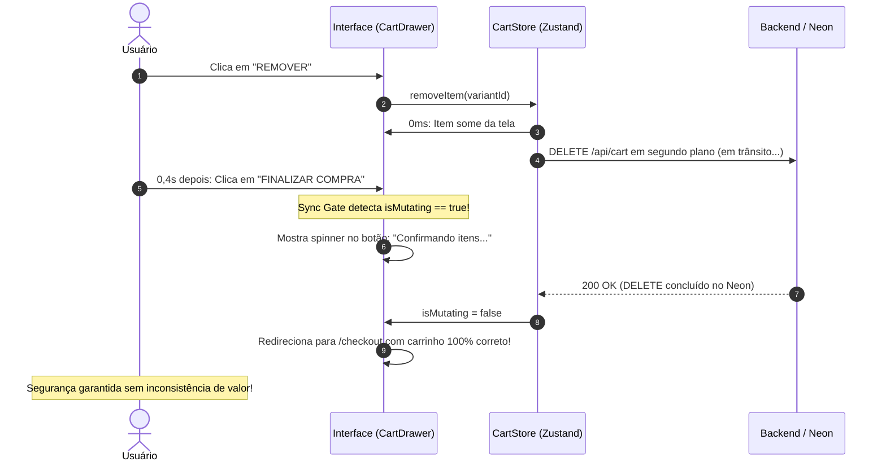

# Arquitetura de Otimização: Interface Otimista (Optimistic UI) e Sync Gate no Carrinho

> **Documento:** Especificação Técnica de Otimização de Performance e UX  
> **Status:** Planejamento Aprovado  
> **Diretório:** `diversos/OTIMIZACOES/Cart/ARQUITETURA_OPTIMISTIC_UI_E_SYNC_GATE_CARRINHO.md`  
> **Data:** Novembro de 2026  

---

## 1. Contexto e Diagnóstico

No modelo atual do sistema, toda operação no carrinho (adicionar, remover ou alterar quantidade) segue a abordagem de **Consistência Estrita Imediata**:
* Ao clicar em "REMOVER" ou "ADICIONAR", o item permanece na tela em estado de carregamento (`isLoading: true`, `isMutating: true`) enquanto o frontend aguarda o ciclo completo de ida e volta da requisição até o servidor na Vercel e o banco de dados Neon.
* Em razão do trajeto transcontinental da Vercel (`iad1` - EUA) até o banco de dados em São Paulo (`sa-east-1`), além da barreira de revalidação de 5 segundos no frontend, a resposta visual leva entre **4,5 e 5 segundos**.
* Embora essa abordagem seja 100% segura contra fraudes e inconsistências de banco, ela gera uma percepção de lentidão ("sistema travado") para o cliente final.

---

## 2. A Solução Proposta: Optimistic UI com "Sync Gate"

A solução transforma a experiência do usuário aplicando o padrão de **Atualização Otimista (*Optimistic UI*)** combinado a um **Portão de Sincronização (*Sync Gate*)** de segurança no botão de finalização:



### Princípios Fundamentais:
1. **Sensação de Resposta Imediata (0ms):** O item desaparece ou aparece na tela no momento exato do clique. O valor total é recalculado no navegador em tempo real.
2. **Processamento em Segundo Plano:** A chamada HTTP real (`POST`, `PATCH` ou `DELETE /api/cart`) é despachada na fila do Zustand sem travar a navegação do usuário.
3. **Consistência Absoluta no Checkout:** O cliente **nunca** avança para a tela de pagamento com mutações pendentes. O botão "FINALIZAR COMPRA" funciona como o *Sync Gate* (Portão de Sincronização), garantindo que o banco Neon tenha gravado tudo antes de abrir o formulário de entrega/pagamento.

---

## 3. Análise de Riscos e Mitigações Técnicas

| Vulnerabilidade / Cenário de Risco | Impacto | Mecanismo de Mitigação (Solução Refinada) |
| :--- | :--- | :--- |
| **Condição de Corrida (Clique Rápido no Checkout)**<br/>Usuário clica em "Remover" e, 0,3s depois, clica em "Finalizar Compra" antes da requisição terminar. | O checkout abriria com os dados antigos do banco, trazendo o produto removido de volta ("efeito fantasma"). | **O Sync Gate no Botão de Checkout:** O botão intercepta o clique, identifica `isMutating === true`, exibe o estado de carregamento sutil (*"Confirmando alterações..."*) e aguarda a promessa do `DELETE` ser resolvida antes de redirecionar para `/checkout`. |
| **Queda ou Instabilidade de Conexão (Offline / 4G oscilando)**<br/>A tela assume o sucesso, mas a requisição falha por timeout ou perda de sinal. | A tela do usuário mostraria um carrinho diferente da realidade do servidor. | **Rollback Gracioso:** O estado anterior é preservado em memória antes da mutação otimista. Se o bloco `.catch()` for disparado, o item reaparece suavemente na tela acompanhado de um toast explicativo: *"Instabilidade na conexão. O item foi restaurado ao carrinho."* |
| **Rajada de Cliques Concorrentes (*Burst Click*)**<br/>Usuário clica repetidamente e rápido em `+`, `-` ou alterna remoções em menos de 1 segundo. | Requisições concorrentes colidem e geram erros `409 Conflict` devido à incompatibilidade de `expectedVersion`. | **Fila FIFO Monotônica no Zustand:** Toda mutação é serializada com `queue = queue.then(...)`. As ações otimistas são aplicadas em cascata na tela, e as requisições HTTP vão sendo disparadas uma após a outra em ordem rigorosa, repassando o `version` atualizado a cada sucesso. |
| **Esgotamento Simultâneo de Estoque**<br/>Usuário clica em "+1", a tela mostra quantidade 2, mas outro cliente comprou o último item no mesmo instante. | O servidor rejeita a adição com `400 / Insufficient stock`. | **Tratamento Específico de Negócio:** O backend retorna o código `INSUFFICIENT_STOCK`. O frontend desfaz o incremento daquele item e avisa: *"A quantidade solicitada não está mais disponível no estoque."* |

---

## 4. Diagrama de Sequência Comparativo

### Cenário A: Usuário com Comportamento Normal (Navegação > 2 segundos)


---

### Cenário B: Usuário Hiper-Rápido (Clique em Checkout em menos de 1 segundo)


---

## 5. Mapeamento Técnico de Implementação

Quando for autorizada a execução desta melhoria, os seguintes arquivos serão ajustados de forma cirúrgica:

### 1. `store/cart.store.ts`
* Adicionar array de itens otimistas:
  ```typescript
  // Snapshot prévio para rollback
  const rollbackCart = get().cart;
  // Mutação otimista local imediata
  if (method === 'DELETE') {
    set({
      cart: currentCart ? {
        ...currentCart,
        items: currentCart.items.filter(i => i.variantID !== parameters.variantID)
      } : null,
      isMutating: true
    });
  }
  ```
* Se o bloco `try` concluir com sucesso: sobrescreve com o snapshot oficial do servidor.
* Se cair no `catch`: restaura o `rollbackCart` e emite o evento de erro para exibição na UI.

### 2. `components/cart/CartDrawer.tsx`
* Animar a saída do item (`framer-motion` ou classe CSS de transição rápida) para que o sumiço seja visualmente agradável e não abrupto.
* Atualizar o botão de Checkout:
  ```tsx
  <CartSummary 
    subtotal={subtotal} 
    total={total} 
    isSyncing={isMutating}
    onCheckout={async () => {
      // Se houver mutações em voo, aguarda a resolução da fila antes de navegar
      if (useCartStore.getState().isMutating) {
        await useCartStore.getState().waitForIdle();
      }
      window.location.assign("/checkout");
    }}
  />
  ```

---

## 6. Conclusão

A combinação de **Optimistic UI (0ms no cliente)** com o **Sync Gate (barreira de segurança no Checkout)** é a fórmula ideal para o projeto:
* Ela resolve o problema do usuário final (que sente o sistema ágil, sem atrasos de 5 segundos ao gerenciar itens);
* Ela mantém a integridade patrimonial do lojista (nenhum pedido é criado sem que o banco de dados oficial tenha persistido e auditado cada item);
* É uma solução elegante, de baixo risco e plenamente compatível com o ecossistema Next.js e Zustand já construído no projeto.

