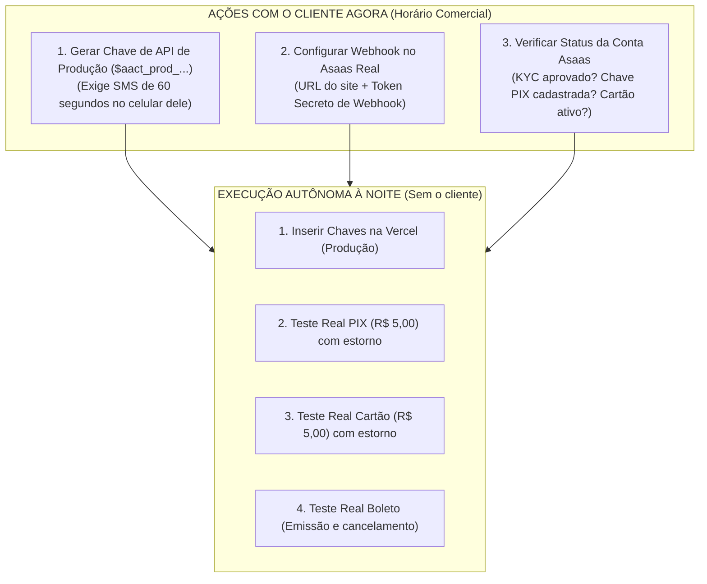

# Plano Operacional: Transição para a Conta Real do Asaas e Testes com Valores Reais

> **Documento:** Guia Operacional de Migração Sandbox $\rightarrow$ Produção e Roteiro de Testes Financeiros  
> **Status:** Planejamento Urgente (Ações diurnas com o cliente + Execução noturna autônoma)  
> **Diretório:** `diversos/PALENJAMENTO_BANCO/Conta_Real/PLANO_MIGRACAO_E_TESTES_CONTA_REAL_ASAAS.md`  
> **Data:** Novembro de 2026  

---

## ⚠️ AÇÃO IMEDIATA (O que você PRECISA solicitar ao cliente AGORA, durante o dia)

Como o painel do Asaas em produção exige **autenticação de dois fatores (token via SMS ou App no celular do cliente)** para qualquer ação sensível, você ficará **100% bloqueado à noite** se não colher estas 3 informações e permissões antes do fim do expediente:

---

### Checklist de Solicitações para o Cliente (Passo a Passo Rápido)

Ligue ou mande mensagem para o cliente solicitando **5 minutos de atenção simultânea** para pegar o token de SMS:

#### 1. Gerar a Chave de API de Produção (`ASAAS_API_KEY`)
1. Peça para o cliente acessar: **[https://www.asaas.com](https://www.asaas.com)** e fazer login (ou você faz o login com as credenciais dele).
2. Vá em: **Configurações da Conta** (ícone de engrenagem / menu do usuário no canto superior direito) > **Integrações** > **Chaves de API**.
3. Clique no botão **"Gerar nova Chave de API"**.
4. **O momento crítico do token:** O Asaas enviará imediatamente um **código SMS de 6 dígitos** para o celular dele. O código expira em 60 segundos. Peça para ele repassar esse código imediatamente.
5. Digite o código. O Asaas exibirá uma chave longa começando obrigatoriamente com:  
   `$aact_prod_...`
6. **ATENÇÃO MÁXIMA:** Copie essa chave e salve em local seguro. **O Asaas NUNCA mais mostra essa chave.** Se fechar a tela sem copiar, terá que gerar outra (e pedir outro SMS).

#### 2. Configurar o Webhook de Produção no Asaas
1. No mesmo menu **Integrações**, clique na aba **Webhooks** > **Cobranças**.
2. Clique em **"Novo Webhook"** (ou Editar se já houver):
   * **Situação:** Ativo.
   * **URL:** `https://<seu-dominio-da-loja.com.br>/api/webhooks/asaas`
   * **E-mail de Notificação:** Seu e-mail de suporte técnico.
   * **Versão da API:** `v3`.
   * **Token de Autenticação:** Crie uma senha/token aleatório e seguro (ex.: `whsec_asaas_prod_continental_2026_x8k9`). Salve esse token, ele será o seu `ASAAS_WEBHOOK_TOKEN`.
   * **Eventos a Marcar (Obrigatórios):**
     * `PAYMENT_CREATED` (Cobrança criada)
     * `PAYMENT_RECEIVED` (Pagamento recebido / PIX instantâneo)
     * `PAYMENT_CONFIRMED` (Pagamento confirmado / Cartão compensado)
     * `PAYMENT_OVERDUE` (Vencido)
     * `PAYMENT_DELETED` (Cancelado/Excluído)
     * `PAYMENT_REFUNDED` (Estornado)
     * `PAYMENT_CHARGEBACK_REQUESTED` (Contestação)
3. Salve o webhook (se pedir token SMS, valide com o cliente).

#### 3. Verificar o Status dos Meios de Pagamento na Conta Real
Olhe no painel do Asaas ou pergunte ao cliente:
* **A conta bancária está aprovada?** (KYC/Documentos validados).
* **Tem chave PIX cadastrada no Asaas?** (Sem chave cadastrada no Asaas, o Asaas rejeita a geração do QR Code dinâmico).
* **Cartão de Crédito está liberado?** (No Asaas, cartão de crédito às vezes precisa de solicitação de liberação com aprovação prévia. Verifique se a opção aparece ativa).

---

## 2. As Variáveis de Ambiente Necessárias (Na Vercel)

Para virar a chave de Sandbox para Produção à noite, estas serão as variáveis configuradas na Vercel (aba *Settings > Environment Variables*):

| Variável na Vercel | Valor para Sandbox (Atual) | Valor para Produção Real (À Noite) |
| :--- | :--- | :--- |
| `ASAAS_API_URL` | `https://api-sandbox.asaas.com/v3` | `https://api.asaas.com/v3` |
| `ASAAS_API_KEY` | `$aact_YTU5YTE...` (chave sandbox) | `$aact_prod_...` (chave real gerada de dia) |
| `ASAAS_WEBHOOK_TOKEN` | Token do webhook sandbox | Token configurado no webhook real |
| `PAYMENT_DEPLOYMENT_ENVIRONMENT` | `SANDBOX` | `PRODUCTION` |
| `ASAAS_ACCOUNT_SCOPE` | `primary` | `primary` |
| `ASAAS_MIN_VALUE` | `5` | `5` (Mínimo de R$ 5,00 por transação) |
| `PAYMENT_WORKER_ENABLED` | `true` | `true` (Para processamento da fila de webhook) |

---

## 3. Roteiro de Testes Noturnos com Dinheiro Real

Os testes noturnos devem utilizar o valor mínimo permitido pelo sistema e pelo Asaas (**R$ 5,00**), utilizando o produto já existente no catálogo: **"ASPIRADOR TESTE" (R$ 5,00)**.

```mermaid
flowchart TD
    subgraph TestePIX["Teste 1: PIX Real (R$ 5,00)"]
        T1A["1. Adiciona Aspirador Teste (R$ 5) ao carrinho"] --> T1B["2. Finaliza pedido via PIX Asaas"]
        T1B --> T1C["3. Lê QR Code no app do seu banco e paga R$ 5,00"]
        T1C --> T1D["4. Webhook recebe PAYMENT_RECEIVED"]
        T1D --> T1E["5. Pedido muda para 'PAID' na hora na tela"]
        T1E --> T1F["6. Acessa Asaas e clica em 'Estornar Cobrança'"]
        T1F --> T1G["7. Os R$ 5,00 voltam para sua conta e pedido vai para REFUNDED"]
    end

    subgraph TesteCartao["Teste 2: Cartão de Crédito Real"]
        T2A["1. Compra de R$ 5,00 com cartão de crédito pessoal"] --> T2B["2. Transação processada em 2 segundos"]
        T2B --> T2C["3. Pedido aprovado instantaneamente"]
        T2C --> T2D["4. Clica em 'Estornar' imediatamente no Asaas"]
        T2D --> T2E["5. Valor estornado na fatura do cartão"]
    end
```

### Roteiro Detalhado Passo a Passo:

#### Teste 1: Fluxo PIX de Ponta a Ponta (Custo do teste: R$ 0,00 após estorno)
1. Abra a vitrine da loja na Vercel como cliente logado.
2. Adicione o **Aspirador Teste** (R$ 5,00) com frete a combinar ou retirada (para manter R$ 5,00 exatos).
3. Selecione a opção de pagamento **PIX**.
4. Copie o código "PIX Copia e Cola" ou aponte a câmera do aplicativo do seu banco (Nubank, Itaú, Inter, etc.).
5. **Transfira os R$ 5,00 reais.**
6. **O que observar no sistema:**
   * O webhook do Asaas deve disparar para a Vercel em 2 a 5 segundos;
   * A tela do pedido deve mudar automaticamente de `PENDING` para **`PAID` (Pago)**;
   * O estoque do produto no banco deve sofrer a baixa definitiva;
   * Um registro de auditoria imutável deve ser gerado no log.
7. **Estorno do Teste:**
   * Entre no painel do Asaas > Cobranças > Localize a cobrança de R$ 5,00 > Clique em **Mais Ações > Estornar Cobrança**.
   * O dinheiro volta instantaneamente para a sua conta bancária.
   * O webhook de estorno dispara e o sistema atualiza o pedido para `REFUNDED` / `CANCELLED`, devolvendo o estoque.

#### Teste 2: Fluxo de Cartão de Crédito Real
1. Realize uma compra teste de R$ 5,00 informando um cartão de crédito pessoal válido.
2. Observe a resposta:
   * Se o Asaas aprovar: o pedido é confirmado imediatamente na tela;
   * Se o Asaas recusar por antifraude ou falta de liberação de cartão na conta: você receberá o código exato da recusa nos logs do sistema para ajuste cadastral.
3. Se aprovado, entre no painel do Asaas e clique em **Estornar** imediatamente (o estorno no mesmo dia anula a transação na fatura sem cobrança de taxas).

#### Teste 3: Fluxo de Boleto Bancário
1. Gere um pedido de R$ 5,00 via Boleto.
2. Verifique se o código de barras, a linha digitável e o PDF do boleto abrem perfeitamente com os dados reais da loja.
3. **Não pague o boleto.** Apenas cancele o pedido pelo painel administrativo para verificar a rotina de expiração/cancelamento.

---

## 4. Plano de Contingência / Rollback Imediato

Se durante os testes noturnos a conta real apresentar alguma pendência cadastral no Asaas (ex.: documento pendente ou webhook bloqueado):
1. **Para voltar instantaneamente ao modo de testes:**
   * Na Vercel, altere `PAYMENT_DEPLOYMENT_ENVIRONMENT` de volta para `SANDBOX`.
   * Altere `ASAAS_API_URL` para `https://api-sandbox.asaas.com/v3`.
   * Reinsira a chave do Sandbox.
   * Dispare o redeploy.
   * O sistema volta a operar em modo simulado em menos de 1 minuto, sem risco de expor erros para clientes reais.

---

## 5. Resumo das Tarefas Diurnas (Ligue para o cliente agora):

1. **Obter a Chave `$aact_prod_...`** (validando o SMS com ele).
2. **Definir o Webhook** apontando para `https://<dominio>/api/webhooks/asaas`.
3. **Confirmar se a chave PIX do Asaas está ativa.**
4. Salvar tudo em um bloco de notas seguro no seu computador.
5. À noite, executar os testes de R$ 5,00 com tranquilidade e autonomia total.
