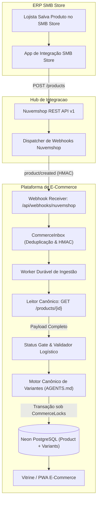

# Arquitetura de Ingestão e Criação Automática de Produtos (SMB Store ➔ Nuvemshop ➔ E-Commerce)

> **Documento:** Especificação Técnica e Arquitetura de Produção (Revisada e Auditada)  
> **Versão:** 2.1 (Pós-Auditoria de Engenharia: Mitigação de Riscos de Frete, Mapeamento Semântico e Ciclo de Vida Reativo)  
> **Data:** 04/11/2026  
> **Status:** Em Revisão Técnica pelo Usuário  
> **Ambiente Alvo:** Produção e Homologação (Multi-Tenant)  
> **Regras de Conformidade:** [`AGENTS.md`](file:///c:/Diversos/TI/Trabalhos/2026/Sistemas/Projeto/AGENTS.md) e [`WORKFLOW_CONTINUIDADE_SMB_NUVEMSHOP_2026-10-30.md`](file:///C:/Diversos/TI/Trabalhos/2026/Sistemas/Projeto-notebook-20261025/diversos/PLANEJAMENTO_GERAL/INTEGRACAO_SMB/WORKFLOW_CONTINUIDADE_SMB_NUVEMSHOP_2026-10-30.md)

---

## 1. Visão Geral e Princípio de Operação

### 1.1. Objetivo
Garantir que qualquer produto cadastrado pelo lojista no ERP físico **SMB Store** seja ingerido, sanitizado, vinculado e disponibilizado para venda no e-commerce de forma **100% autônoma**, eliminando qualquer etapa manual de cadastro duplicado ou vinculação assistida.

### 1.2. Topologia Geral do Pipeline



---

## 2. Mitigações Críticas e Regras de Negócio Blindadas

A partir da análise crítica e auditoria das camadas de banco de dados, motor de frete e concorrência, o pipeline incorpora as seguintes diretrizes:

### 2.1. Status Gate & Quarentena Operacional (Sem Adulteração de Schema)
O lojista no balcão pode salvar um produto incompleto no ERP antes de definir fotos, descrição ou precificação final.
- **Critérios para Publicação Ativa na Vitrine:**
  1. `price > 0.00` (Preço de venda definido);
  2. `name` com comprimento mínimo de 2 caracteres;
  3. `visibility === 'visible'` na Nuvemshop.
- **Mecanismo de Quarentena Operacional (Compatível com Schema Prisma):**
  - O modelo `Product` do Prisma não possui coluna booleana `published`. A visibilidade na vitrine é regulada por `retiredAt: null` e estoque vendível online (`stock - stockBuffer > 0`).
  - Produtos incompletos (preço zero, sem nome ou ocultos na Nuvemshop):
    - São salvos no banco para registrar o vínculo canônico com o `nuvemshopProductId`;
    - O estoque é registrado com `stock: 0` e `stockBuffer: 0`, e adicionada a tag interna `'_QUARENTENA_OPERACIONAL_'` no array `tagsSearchCache`;
    - O produto permanece invisível para venda na vitrine até que o webhook `product/updated` receba a precificação e dados definitivos.
    - Gravação de auditoria: `PRODUCT_INGESTED_IN_QUARANTINE`.

### 2.2. Motor de Variantes e Ciclo de Vida Reativo ("Un-retire" Idempotente)
Regras alinhadas às diretrizes do [`AGENTS.md`](file:///c:/Diversos/TI/Trabalhos/2026/Sistemas/Projeto/AGENTS.md):
- **Fase A (Produto Simples / 1 Variante):**
  Utiliza estritamente `size: "Único"` e `color: "Padrão"`.
- **Fase B (Transição para Grade de Variações):**
  Se o produto receber grade posteriormente (ex.: P, M, G):
  - A variante neutra original é aposentada (`retiredAt = new Date()`, `stock = 0`) para preservar integridade de pedidos antigos;
  - As novas variantes da grade são criadas vinculadas aos seus respectivos `nuvemshopVariantId`;
  - Nenhuma variante é excluída via `DELETE` (preservação estrita de chaves estrangeiras).
- **Mitigação Crítica: Reativação Graciosa ("Un-retire" Idempotente):**
  - Se o lojista excluir um produto ou variante e depois re-cadastrar no ERP com o mesmo SKU/combinação:
  - O motor canônico evita o disparo de `ProductConflictError('VARIANT_REACTIVATION_REQUIRED')` limpando o `retiredAt` (`retiredAt: null`), restaurando o estoque atualizado e sincronizando a versão de catálogo de forma atômica.

### 2.3. Heurística Inteligente de Frete e Proteção Financeira (3-Tier Engine)
Substitui a regra antiga de faixa de preço (que causava prejuízo em produtos pesados baratos e bloqueava produtos caros leves) por um motor de avaliação logística em 3 etapas:

- **Tier 1: Parser Regex de Peso no Título e Descrição:**
  - Lojistas frequentemente inserem o peso no nome do produto quando não preenchem o campo de cubagem do ERP (ex.: *"Ração Golden 15kg"*, *"Argamassa 20kg"*, *"Tinta Acrílica 18L"*, *"Café Torrado 500g"*).
  - Um parser regex sanitiza e extrai esses dados automaticamente:
    - `15kg` / `15 kg` $\to$ `15000g`
    - `500g` $\to$ `500g`
    - `18L` / `18 l` $\to$ `18000g`
- **Tier 2: Conversão Rigorosa de Unidades Nuvemshop:**
  - A Nuvemshop API envia o peso em **quilogramas fracionários (`kg`)** (ex.: `"0.500"`).
  - O e-commerce armazena inteiros em **gramas (`weightInGrams: Int?`)**.
  - O conversor normaliza: `weightInGrams = Math.round(Number(rawWeightKg) * 1000)`.
- **Tier 3: Blindagem do Motor de Frete ([`lib/freight/authority.ts`](file:///c:/Diversos/TI/Trabalhos/2026/Sistemas/Projeto/lib/freight/authority.ts)):**
  - O validador do frete lança exceção fatal `FREIGHT_DIMENSIONS_INVALID` se qualquer dimensão for $\le 0$.
  - Para blindar o checkout contra falhas:
    - $\text{weightInGrams} = \max(300, \text{calculatedWeight})$;
    - $\text{lengthCm} = \max(16, \text{calculatedLength})$;
    - $\text{widthCm} = \max(11, \text{calculatedWidth})$;
    - $\text{heightCm} = \max(4, \text{calculatedHeight})$.
- **Alerta de Pacotes Superdimensionados:**
  - Se o item exceder os limites operacionais dos Correios (peso $> 30\text{ kg}$ ou soma das dimensões $> 200\text{ cm}$), o produto recebe a tag `'_FRETE_ESPECIAL_'` e alerta o administrador para cotação via transportadora dedicada.

### 2.4. Resolução Dinâmica de Usuário do Tenant com Cache Otimizado
O modelo `Product` do Prisma exige chave estrangeira obrigatória com `User` (`userID`).
- A ingestão consulta dinamicamente o administrador ativo da loja:
  ```typescript
  const tenantAdmin = await tx.user.findFirst({
    where: {
      lojaID: loja.id,
      role: 'ADMIN',
      status: 'ACTIVE',
    },
    select: { id: true },
    orderBy: { createdAt: 'asc' },
  });
  ```
- **Otimização:** Resultado mantido em cache em memória (`tenantAdminCache`) com TTL de 5 minutos, evitando consultas repetitivas ao banco a cada evento de produto.

### 2.5. Auto-Cura e Supervisão de Webhooks
O serviço de supervisão contínua (`lib/integrations/nuvemshop-supervision.ts`) executa auditoria e provisionamento automático:
1. Valida a integridade do token OAuth da loja antes de disparar chamadas;
2. Verifica e registra os 3 webhooks de catálogo: `product/created`, `product/updated` e `product/deleted`;
3. Registra logs auditáveis se as credenciais precisarem de renovação pelo lojista.

---

## 3. Mapeamento Semântico e Normalização de Dados

### 3.1. Imagens e Mídias
- **Origem:** URLs canônicas HTTPS do CDN Nuvemshop (`dcdn-us.mitiendanube.com/...`).
- **Conformidade de Segurança:** Domínio já homologado no `next.config.js` (`images.remotePatterns` e cabeçalhos de CSP).
- **Mapeamento:**
  - Imagem 1 $\to$ `Product.imageUrl`;
  - Imagens subsequentes $\to$ `Product.galleryUrls`;
  - Caso o produto seja cadastrado sem imagem no ERP, aplica o placeholder padrão institucional do Cloudinary.

### 3.2. Categorias e Reconciliação Diferencial de Tags
- O campo `Grupo` do SMB Store sincroniza com as `categories` da Nuvemshop;
- O e-commerce utiliza o modelo correto do Prisma: **`CategoryTag`** e a tabela pivô **`ProductCategoryTag`**:
  - Busca correspondência semântica por nome (case-insensitive e sem acentos);
  - Realiza a reconciliação diferencial: vincula novas categorias e desvincula relações removidas no ERP;
  - Atualiza o array `tagsSearchCache` eliminando tags zumbis, garantindo indexação limpa na busca da loja.

---

## 4. Especificação das Fases de Implementação

### Fase 1: Extensão do Receptor de Webhook e Fila Durável
- **Arquivos:**
  - `lib/integrations/nuvemshop-webhook.ts` (Novo)
  - `app/api/webhooks/nuvemshop/route.ts` (Novo)
- **Ações:**
  - Validação de assinatura HMAC da Nuvemshop;
  - Gravação do evento no `CommerceInbox` sob idempotência estrita;
  - Enfileiramento do comando `NUVEMSHOP_PRODUCT_INGEST` no `CommerceOutbox`.

### Fase 2: Módulo Especialista de Ingestão e Sanitização
- **Arquivos:**
  - `lib/integrations/nuvemshop-product-ingestion.ts` (Novo)
  - `services/payment/payment-outbox.service.ts` (Conexão do Worker)
- **Ações:**
  - Chamada canônica `GET /v1/{store_id}/products/{id}`;
  - Parser Regex de frete (Tier 1 a 3) e sanitização de dimensões;
  - Mapeamento e reconciliação diferencial de `CategoryTag` e `ProductCategoryTag`;
  - Transação atômica sob `CommerceLocks('product', [id])` e lock por `nuvemshopProductId`;
  - Desativação atômica em cascata para `product/deleted` (produto + variantes + liberação de reservas);
  - Reativação graciosa ("un-retire") para produtos recadastrados.

### Fase 3: Provisionamento e Supervisão de Webhooks
- **Arquivos:**
  - `lib/integrations/nuvemshop-supervision.ts`
- **Ações:**
  - Verificação e auto-provisionamento de `product/created`, `product/updated` e `product/deleted`.

### Fase 4: Bateria de Testes Automatizados (Vitest)
- **Arquivos:**
  - `tests/unit/nuvemshop-product-ingestion.test.ts` (Novo)
- **Casos de Teste Obrigatórios:**
  1. Ingestão de produto simples com `size: "Único"` e `color: "Padrão"`;
  2. Ingestão de produto com grade múltipla de variantes;
  3. Produto com peso zero $\to$ Fallback seguro de frete ($\ge 300\text{g}$);
  4. Produto com peso no título (ex.: *"Ração 15kg"*) $\to$ Extração precisa de 15.000g;
  5. Produto incompleto ou sem preço $\to$ Quarentena operacional;
  6. Reconciliação de tags $\to$ Zero acúmulo de tags zumbis;
  7. Exclusão e recadastro $\to$ Reativação limpa sem erro de `VARIANT_REACTIVATION_REQUIRED`.

---

## 5. Critérios de Aceite para Conclusão

1. **Zero Ação Manual:** Produto cadastrado no SMB Store reflete no e-commerce automaticamente em menos de 10 segundos;
2. **Blindagem Financeira de Frete:** Nenhum produto é cadastrado com peso $\le 0$, impedindo prejuízos de frete subdimensionado ou travamento no checkout;
3. **Consistência de Variantes e Estoque:** Transições de grade e exclusões respeitam o histórico de pedidos e integridade referencial;
4. **Qualidade de Código:** 100% dos testes unitários passando, TypeScript typecheck sem erros (`tsc --noEmit`) e linter aprovado.
