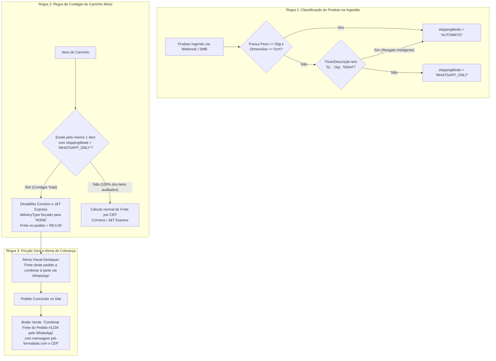

# Plano de Proteção Financeira de Frete e Tratamento de Produtos sem Medidas (WhatsApp Fallback)

> **Documento:** Especificação e Plano de Decisão Arquitetural  
> **Status:** Aprovado para Implementação Futura  
> **Diretório:** `diversos/PLANEJAMENTO_AUTOMACAO/PLANO_PROTECAO_FRETE_E_MEDIDAS_WHATSAPP.md`  
> **Data:** Novembro de 2026  

---

## 1. Contexto e Diagnóstico

O lojista cadastrou os produtos no ERP **SMB Store Online** sem preencher os dados de peso (em kg/g) e dimensões de embalagem (comprimento, largura, altura).

### O Risco Financeiro do Modelo Anterior
Anteriormente, produtos sem peso e dimensões recaiam no Tier 3 da heurística de frete (mínimos dos Correios: **300g** e **16x11x4 cm**).
* **Cenário de Prejuízo:** Se um cliente comprasse um galão de 5 Litros (5,3 kg) ou uma lavadora de alta pressão (10 kg), o sistema calculava uma cotação irreal de ~R$ 18,00. No momento do envio no balcão da transportadora, o valor real era de R$ 75,00, gerando um prejuízo direto de mais de R$ 50,00 para o lojista em cada pedido.
* **Cenário Indesejado de Bloqueio:** Bloquear o envio e obrigar "Retirada na Loja" inviabilizaria vendas para clientes de outras cidades ou estados.

---

## 2. Objetivos Principais do Modelo Aprovado

1. **Garantir Viabilidade de Envio:** Nenhum produto deve ficar restrito à retirada na loja física apenas por ausência de peso cadastrado. Clientes de qualquer localidade continuam aptos a comprar.
2. **Prevenção Absoluta de Prejuízo Financeiro:** Nem o lojista nem o cliente devem arcar com valores incorretos de frete. A cotação automática só é executada quando as medidas forem reais e confiáveis.
3. **Transição Gradual e Automatizada:** À medida que o lojista cadastrar peso e medidas nos produtos novos (ou atualizar o cadastro na SMB Store), o sistema automaticamente reabilita a cotação oficial dos Correios/J&T Express para aquele item sem necessidade de intervenção técnica manual.
4. **Isolamento Estrito do Programa de Pontos:** Os pontos de fidelidade (*cashback*) e cupons continuam incidindo exclusivamente sobre o valor da mercadoria (`merchandiseSubtotal`), sem qualquer abatimento ou confusão com o frete.

---

## 3. Especificação das 3 Regras de Negócio Aprovadas

---

### Regra 1: Classificação Automatizada na Ingestão (`shippingMode`)

Durante a sincronização automática com a Nuvemshop/SMB Store, o produto é auditado:
* **Critério de Validação Confiável:**
  * `weightInGrams >= 50` E
  * `lengthCm >= 5` E
  * `widthCm >= 5` E
  * `heightCm >= 2`
* Se os dados do ERP forem válidos ou se o Tier 1 (Regex de resgate no nome/descrição, ex.: `"5L"`, `"1kg"`, `"500ml"`) inferir com sucesso:
  $$\text{shippingMode} = \mathbf{AUTOMATIC}$$
* Se não houver medidas e a heurística não inferir com segurança:
  $$\text{shippingMode} = \mathbf{WHATSAPP\_ONLY}$$

---

### Regra 2: Prevalência do Carrinho Misto (Regra de Contágio)

Para impedir que um produto pesado sem medidas "viaje de carona" em um pacote barato cotado para um produto leve:
* **Fórmula de Decisão:**
  $$\text{Se } \exists \, \text{item} \in \text{Carrinho} \text{ onde } \text{shippingMode} == \text{'WHATSAPP\_ONLY'} \implies \mathbf{Carrinho = WHATSAPP\_ONLY}$$
* Se **todos os itens** possuírem medidas auditadas: o cálculo por CEP (Correios / J&T) é exibido normalmente.
* Se **ao menos um item** exigir WhatsApp:
  * As opções de transportadora automática são suprimidas.
  * O método selecionado é fixado em `deliveryType = 'NONE'` (*"A Combinar via WhatsApp"*).
  * O custo de frete no pedido é registrado como `R$ 0,00`.

---

### Regra 3: Transparência Radical e Pagamento em 2 Etapas

Para eliminar o risco de o cliente achar que o frete era grátis e cancelar o pedido:
1. **No Card do Produto e no Carrinho:**
   * Badge sutil: `Frete a combinar via WhatsApp`.
2. **Na Etapa de Frete do Checkout:**
   * Alerta informativo:  
     > ⚠️ **Atenção:** O frete deste pedido **não está incluso** no total a ser pago agora. Após a confirmação da compra dos produtos, o frete será calculado e acertado diretamente com a loja pelo WhatsApp antes do envio.
3. **Na Tela de Sucesso (`/checkout/confirmation`):**
   * Botão em destaque verde integrado à API do WhatsApp (`https://wa.me/{numeroLoja}?text=...`):
     > *"Olá! Acabei de concluir o pedido #1042 no site. Meus itens têm frete a combinar e gostaria de cotar o envio para o meu CEP [01001-000]."*

---

## 4. Proteção do Programa de Pontos e Totais Financeiros

O plano financeiro gerado em `services/payment/financial-plan.service.ts` preserva as garantias inegociáveis:

$$\text{Subtotal Líquido (Net)} = \text{MerchandiseSubtotal} - \text{LoyaltyDiscount}$$
$$\text{Total Comercial} = \text{Subtotal Líquido} + \text{ShippingCost (R\$ 0,00)}$$
$$\text{Base de Cashback em Pontos} = \text{Subtotal Líquido}$$

* O cliente pode pagar o produto com pontos, cartão ou PIX no site.
* O valor de frete a ser pago posteriormente no WhatsApp é uma negociação de transporte pura entre o cliente e a loja física, sem interferir no balanço fiscal do e-commerce.

---

## 5. Roteiro de Implementação Técnica Futura

Quando autorizado o início do desenvolvimento desta melhoria:
1. **Banco de Dados:** Garantir que o schema do Produto e Variante reflita a flag ou o cômputo de `shippingMode`.
2. **Orquestrador de Frete (`services/freight/orchestrator.service.ts`):** Injetar a validação do carrinho misto para ativar a opção `NONE` automaticamente.
3. **Componentes de UI:** Adicionar a badge de `Frete a combinar` no card de produto e a mensagem explicativa no Checkout.
4. **Página de Confirmação:** Injetar o botão dinâmico para abertura direta do WhatsApp com o número e o texto preenchido.

