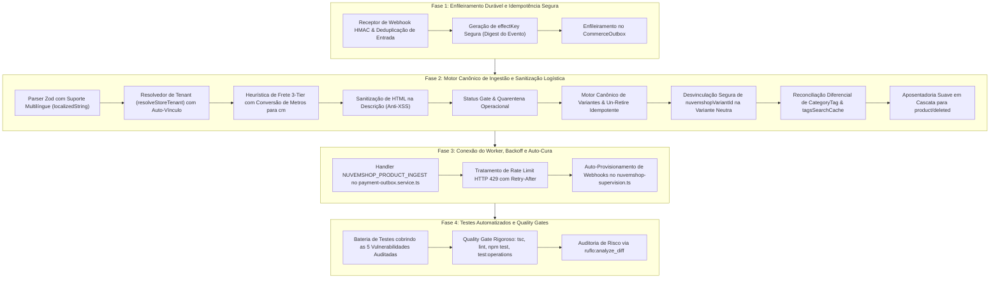

# Workflow de Implementação: Ingestão e Criação Automática de Produtos (SMB Store ➔ Nuvemshop ➔ E-Commerce)

> **Documento:** Roteiro Operacional de Implementação e Verificação  
> **Versão:** 1.1 (Pós-Auditoria Crítica: Mitigação das 5 Vulnerabilidades e 5 Refinamentos de Engenharia)  
> **Data:** 05/11/2026  
> **Status:** Aguardando Análise e Autorização do Usuário (NÃO IMPLEMENTAR AINDA)  
> **Ambiente Alvo de Desenvolvimento:** Worktree Isolado `c:\Diversos\TI\Trabalhos\2026\Sistemas\Projeto-notebook-20261025` na branch `homologacao_teste`  
> **Repositório Base:** `c:\Diversos\TI\Trabalhos\2026\Sistemas\Projeto` (Estritamente Preservado / Intocado)  
> **Especificação Base:** [`ARQUITETURA_INGESTAO_AUTOMATICA_PRODUTOS_SMB_NUVEMSHOP.md`](file:///c:/Diversos/TI/Trabalhos/2026/Sistemas/Projeto/diversos/PLANEJAMENTO_AUTOMACAO/ARQUITETURA_INGESTAO_AUTOMATICA_PRODUTOS_SMB_NUVEMSHOP.md) (v2.1)  
> **Regras de Governança:** [`AGENTS.md`](file:///c:/Diversos/TI/Trabalhos/2026/Sistemas/Projeto/AGENTS.md)

---

## 1. Avaliação Estratégica dos MCPs Disponíveis

Para assegurar máxima assertividade, blindagem contra regressões e precisão cirúrgica na execução, os seguintes MCPs foram analisados:

| Servidor MCP | Ferramentas Relevantes | Aplicação Específica no Workflow |
| :--- | :--- | :--- |
| **`ruflo`** | `analyze_diff`<br>`analyze_diff-risk`<br>`analyze_file-risk` | **Auditoria Contínua de Risco:** Avaliação estática de diffs antes de cada commit para garantir que nenhuma alteração introduza regressão em contratos existentes de `Product`, `ProductVariants` ou checkout. |
| **`ruflo`** | `aidefence_scan`<br>`aidefence_is_safe` | **Validação de Segurança e Sanitização:** Checagem de robustez contra injeção de payloads maliciosos oriundos de webhooks externos, sanitização de HTML na descrição e prevenção de vazamento de credenciais nos logs. |
| **`ruflo`** | `task_create`<br>`task_update`<br>`task_complete` | **Rastreabilidade Fina:** Rastreamento formal do progresso de cada fase do pipeline, documentando bloqueios e conclusões parciais. |
| **`ruflo`** | `policy_evaluate` | **Verificação de Regras do `AGENTS.md`:** Checagem automatizada para validar que variantes respeitam `size: "Único"`, `color: "Padrão"`, isolamento sob `CommerceLocks` e ausência de hard deletes destrutivos. |
| **`ruflo`** | `memory_store`<br>`memory_retrieve` | **Persistência de Decisões Arquiteturais:** Armazenamento das chaves de idempotência e mapeamento semântico entre execuções. |
| **`21st`** | `get_component`, `search` | **Classificação:** Baixa relevância para o core da ingestão (este workflow é 100% backend/integração/fila assíncrona). Pode ser consultado caso no futuro seja necessário um widget visual para o lojista gerenciar itens em quarentena no Admin. |

---

## 2. Mapa de Fases de Implementação Refinado



---

## 3. Detalhamento Passo a Passo das Fases

### Fase 1: Enfileiramento Durável e Idempotência Segura (Mitigação V1)

* **Objetivo:** Garantir que o recebimento de qualquer evento de produto na Nuvemshop seja autenticado via HMAC, deduplicado na entrada e imediatamente enfileirado para processamento assíncrono durável, **sem bloquear atualizações futuras do mesmo produto**.
* **Arquivos Afetados:**
  * `lib/integrations/nuvemshop-webhook.ts`
  * `app/api/webhooks/nuvemshop/route.ts`
* **Tarefas Técnicas:**
  1. No `receiveNuvemshopWebhook`, estender a validação para identificar eventos de catálogo (`product/created`, `product/updated`, `product/deleted`).
  2. **Correção Crítica de Idempotência (`effectKey`):**
     * Para evitar a colisão no índice único `@unique` de `CommerceOutbox` que congelaria atualizações futuras de preço/estoque:
       ```typescript
       // Chave vinculada ao digest do evento individual recebido
       const bodyDigest = createHash('sha256').update(options.rawBody).digest('hex');
       const effectKey = `nuvemshop-product-ingest:${payload.store_id}:${payload.id}:${bodyDigest.slice(0, 16)}`;
       ```
     * Dessa forma, cada alteração legítima disparada pelo lojista gera uma tarefa única e executável.
  3. Dentro da transação do banco:
     * Registrar o evento em `paymentWebhookEvent` (já existente);
     * Enfileirar o comando durável `NUVEMSHOP_PRODUCT_INGEST` na tabela `commerceOutbox`:
       ```typescript
       await tx.commerceOutbox.upsert({
         where: { effectKey },
         create: {
           effectKey,
           commandType: 'NUVEMSHOP_PRODUCT_INGEST',
           aggregateId: payload.id,
           payload: {
             schemaVersion: 1,
             storeId: payload.store_id,
             productId: payload.id,
             event: payload.event,
             receivedAt: new Date().toISOString(),
           },
         },
         update: {},
       });
       ```
  4. Devolver resposta HTTP 200 para a Nuvemshop em menos de 500ms.

---

### Fase 2: Motor Canônico de Ingestão e Sanitização Logística (Mitigações V2, V3, V4, V5)

* **Objetivo:** Construir o serviço especialista responsável por consumir a API canônica da Nuvemshop, resolver o tenant, sanitizar cubagem e dados cadastrais, resolver variantes segundo o [`AGENTS.md`](file:///c:/Diversos/TI/Trabalhos/2026/Sistemas/Projeto/AGENTS.md) e persistir o produto com integridade absoluta.
* **Arquivo a Criar:**
  * `lib/integrations/nuvemshop-product-ingestion.ts`
* **Tarefas Técnicas:**

#### 2.1. Parser Zod Resiliente a Campos Multilíngues (Mitigação V2)
A API v1 da Nuvemshop envia strings e descrições frequentemente em formato de objeto multilíngue (`{ pt: "...", es: "..." }`).
* Implementar o transformador seguro:
  ```typescript
  const localizedString = z.union([
    z.string(),
    z.record(z.string(), z.string()),
  ]).transform(val => {
    if (typeof val === 'string') return val.trim();
    return (val.pt || Object.values(val)[0] || '').trim();
  });
  ```
* Schema canônico completo:
  * `id`: string
  * `name`: `localizedString` (mínimo 1 caractere)
  * `description`: `localizedString`
  * `price`: `z.string().or(z.number())`
  * `weight`: `z.string().or(z.number()).nullable().optional()`
  * `depth`, `width`, `height`: `z.string().or(z.number()).nullable().optional()`
  * `images`: array de objetos com `src` HTTPS
  * `categories`: array de objetos com `id` e `name` (`localizedString`)
  * `variants`: array com `id`, `sku`, `price`, `stock`, `values` (`localizedString[]`)
  * `visibility`: `'visible' | 'unlisted' | 'hidden'`

#### 2.2. Resolução Dinâmica de Tenant (`lojaID`) com Auto-Vínculo (Mitigação V3)
Implementar `resolveStoreTenant(storeId: string, tx: Prisma.TransactionClient)`:
1. Buscar `tx.loja.findFirst({ where: { nuvemshopStoreId: storeId } })`.
2. **Fallback e Auto-Vínculo:** Se não encontrar por `nuvemshopStoreId`, buscar a loja única ativa do sistema (caso da Continental). Se existir exatamente 1 loja ativa:
   * Associa o produto a ela;
   * Atualiza `tx.loja.update({ where: { id: loja.id }, data: { nuvemshopStoreId: storeId } })` para auto-conectar os próximos eventos.
3. Se nenhuma loja for elegível, abortar com `TENANT_NOT_RESOLVED` para revisão manual.

#### 2.3. Proteção Financeira de Frete (Heurística 3-Tier com Normalização Métrica) (Mitigação V5)
Blindar contra o erro fatal `FREIGHT_DIMENSIONS_INVALID` em [`lib/freight/authority.ts`](file:///c:/Diversos/TI/Trabalhos/2026/Sistemas/Projeto/lib/freight/authority.ts#L44):
1. **Tier 1 (Parser Regex):** Analisar nome e descrição com:
   `/(?:peso|conteúdo|embalagem)?\s*(\d+(?:[.,]\d+)?)\s*(kg|kilo|g|grama|l|litro)\b/i`
   * Quilogramas e Litros convertidos para gramas ($\times 1000$).
2. **Tier 2 (Conversão e Normalização de Escala Nuvemshop):**
   * *Peso:* `rawWeightKg` convertido para gramas inteiras: `Math.round(Number(rawWeight || 0) * 1000)`.
   * *Dimensões (Metros vs Centímetros):*
     * Se dimensão $> 0$ e $< 1.0$ (ex: `0.16`), normalizar multiplicando por 100 ($\implies 16\text{ cm}$).
     * Se dimensão for $\le 0$ ou ausente, usar os padrões oficiais dos Correios.
3. **Tier 3 (Piso Mínimo dos Correios):**
   * $\text{weightInGrams} = \max(300, \text{pesoCalculado})$
   * $\text{lengthCm} = \max(16, \text{comprimentoCalculado})$
   * $\text{widthCm} = \max(11, \text{larguraCalculada})$
   * $\text{heightCm} = \max(4, \text{alturaCalculada})$
4. **Proteção de Carga Pesada:** Se peso $> 30\text{kg}$ ou $C+L+A > 200\text{cm}$, adicionar tag interna `'_FRETE_ESPECIAL_'`.

#### 2.4. Sanitização de HTML e Resolução de Preço Heterogêneo
* **Higienização de HTML:** Sanitizar a `description` removendo tags maliciosas (`<script>`, `<iframe>`, `on*`) e mantendo formatação básica (`<p>`, `<br>`, `<strong>`), prevenindo vulnerabilidades de XSS na vitrine.
* **Preço do Produto Pai:** Caso a grade remota tenha variantes com preços divergentes, atribuir a `Product.price` o menor valor da grade (`Math.min(...variants.map(v => Number(v.price)))`).

#### 2.5. Status Gate & Quarentena Operacional
* Se `price <= 0`, nome com $< 2$ caracteres, ou marcado como `unlisted/hidden`:
  * Salvar o registro no banco com `stock: 0` e `stockBuffer: 0`;
  * Adicionar tag `'_QUARENTENA_OPERACIONAL_'` no array `tagsSearchCache`;
  * Gravar log de auditoria `PRODUCT_INGESTED_IN_QUARANTINE`.
* Se o produto for completo:
  * Definir `stockBuffer: 1` (regra mandatória omnichannel para proteção do balcão);
  * Atribuir estoque correspondente.

#### 2.6. Motor de Variantes, Desvinculação Limpa e Un-Retire Idempotente (Mitigação V4)
Sob lock transacional `CommerceLocks('product', [id])`:
* **Fase A (Produto Simples):** Criar variante com `size: "Único"` e `color: "Padrão"`, vinculando ao primeiro `variant.id` da Nuvemshop.
* **Fase B (Transição para Grade):** Ao receber variações (P, M, G):
  * **Desvinculação Segura:** Aposentar a variante neutra antiga (`retiredAt = new Date()`, `stock = 0`) e setar **`nuvemshopVariantId = null`**, liberando o identificador para a nova grade sem conflitos de unicidade.
  * Inserir as novas variantes da grade com seus respectivos `nuvemshopVariantId`.
* **Reativação Graciosa ("Un-retire" Idempotente):** Caso o produto ou variante já exista com `retiredAt !== null` (exclusão prévia no ERP):
  * Reativar limpando `retiredAt = null`;
  * Restaurar o estoque atualizado sem disparar a exceção `VARIANT_REACTIVATION_REQUIRED`.

#### 2.7. Reconciliação Diferencial de Categorias
* Mapear os `Grupos` do SMB Store / Nuvemshop para o modelo **`CategoryTag`** do tenant;
* Reconciliar a tabela pivô **`ProductCategoryTag`** (criar vínculos novos e remover vínculos desfeitos no ERP);
* Sincronizar o array `tagsSearchCache` no `Product`, eliminando tags zumbis.

#### 2.8. Aposentadoria Suave em Cascata (`product/deleted`)
* Ao receber o evento de exclusão, **NUNCA** chamar o método destrutivo `deleteProduct()` de [`services/product.service.ts`](file:///c:/Diversos/TI/Trabalhos/2026/Sistemas/Projeto/services/product.service.ts#L363) (que falharia com `PRODUCT_IN_USE` em itens vendidos).
* Em vez disso, executar transação atômica especializada:
  1. `Product.retiredAt = new Date()`, `Product.stock = 0`;
  2. `ProductVariants.retiredAt = new Date()`, `ProductVariants.stock = 0`;
  3. Cancelar quaisquer reservas de estoque pendentes (`InventoryReservation`) associadas.

---

### Fase 3: Conexão do Worker, Backoff e Auto-Cura

* **Objetivo:** Habilitar a execução assíncrona dos comandos de ingestão pelo worker outbox com tolerância a falhas e rate limits, além de garantir o provisionamento automático de webhooks.
* **Arquivos Afetados:**
  * `services/payment/payment-outbox.service.ts`
  * `lib/integrations/nuvemshop-supervision.ts`
* **Tarefas Técnicas:**
  1. No `drainPaymentOutbox` / `drainNuvemshopOutbox`, adicionar o bloco consumidor para `NUVEMSHOP_PRODUCT_INGEST`:
     * Chamar `ingestProductFromNuvemshop(entry.payload)`;
     * **Tratamento de Rate Limit (HTTP 429):** Se a Nuvemshop responder `HTTP 429`, capturar o cabeçalho `Retry-After` (ou aplicar backoff exponencial de 30s) e reagendar a execução via `retryWork(id, owner, 'RATE_LIMIT', retryAfterMs)`;
     * Em caso de sucesso (`INGESTED`, `UPDATED`, `RETIRED`), marcar como concluído (`completeWork`);
     * Em caso de quarentena, registrar como `COMPLETED` com log de quarentena.
  2. No `nuvemshop-supervision.ts`:
     * Implementar rotina `ensureNuvemshopWebhooksProvisioned(storeId, accessToken)`:
       * Consultar `GET /v1/{store_id}/webhooks`;
       * Se `product/created`, `product/updated` ou `product/deleted` não estiverem registrados, criá-los automaticamente via `POST /v1/{store_id}/webhooks` apontando para a URL do e-commerce.

---

### Fase 4: Bateria de Testes Automatizados e Quality Gates

* **Objetivo:** Comprovar formalmente a neutralização de todas as vulnerabilidades e a conformidade total do pipeline.
* **Arquivo a Criar:**
  * `tests/unit/nuvemshop-product-ingestion.test.ts`
* **Casos de Teste Obrigatórios (Cobrem as 5 Vulnerabilidades Auditadas):**
  1. *Mitigação V1 (Atualizações Múltiplas do Mesmo Produto):* Verifica que 2 webhooks `product/updated` sucessivos para o mesmo produto são enfileirados e processados sem colisão de chave única no outbox.
  2. *Mitigação V2 (Dados Multilíngues):* Ingestão de produto cujo `name` e `description` vêm no formato `{ pt: "Produto", es: "Producto" }` processa com sucesso.
  3. *Mitigação V3 (Resolução de Tenant):* Verifica auto-vínculo quando `nuvemshopStoreId` não estava preenchido previamente na loja.
  4. *Mitigação V4 (Transição para Grade):* Verifica que a variante neutra é aposentada e tem seu `nuvemshopVariantId` liberado (`null`) para a grade assumir o vínculo.
  5. *Mitigação V5 (Normalização Métrica):* Produto enviado com dimensão em metros (`0.16`) é convertido para 16 cm e não estoura erro no frete.
  6. *Proteção de Frete (Regex de Título):* Produto *"Ração Golden 15kg"* extrai peso de 15.000g.
  7. *Status Gate (Quarentena):* Produto com `price: 0` entra em quarentena com `stock: 0` e tag `_QUARENTENA_OPERACIONAL_`.
  8. *Reativação Graciosa ("Un-retire"):* Produto excluído e recadastrado tem `retiredAt` limpo para `null` sem disparar erro de conflito.
  9. *Aposentadoria em Cascata:* Evento `product/deleted` desativa produto e variantes sem invocar método destrutivo.
  10. *Sanitização Anti-XSS:* Injeção de tags maliciosas na descrição é limpa com segurança.
* **Quality Gates Obrigatórios:**
  * Executar `npx tsc --noEmit` (0 erros de tipagem).
  * Executar `npm run lint` (0 erros de linter).
  * Executar `npm test` (100% dos testes aprovados, mantendo as 102 suítes existentes).
  * Executar `npm run test:operations` (32 testes de operações aprovados).
  * Auditoria de diff e risco via MCP `ruflo:analyze_diff`.

---

## 4. Critérios de Homologação e Conclusão

1. **Automação Completa:** Lojista salva produto no ERP SMB Store e, em menos de 10 segundos, o item surge cadastrado no banco do e-commerce com imagem, peso e estoque.
2. **Zero Risco de Frete:** Nenhum produto é gravado com peso ou dimensão $\le 0$ no Postgres;
3. **Respeito Estrito ao Balcão Físico:** Produtos ingeridos recebem por padrão `stockBuffer = 1`, preservando a proteção omnichannel já homologada.
4. **Preservação de Branches:** Diretório base `Projeto` intocado; implementação realizada estritamente no worktree de homologação.
