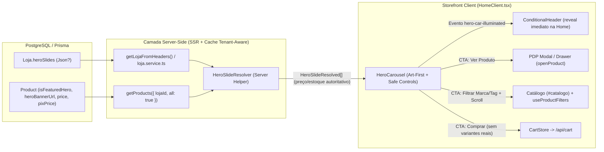

# Arquitetura de Implementação — Substituição do Vídeo de Abertura por Carrossel de Painéis com Arte dos Produtos (Hero)

> **Status:** Especificação Arquitetural (Sem Implementação)  
> **Escopo:** Substituição do vídeo de abertura (`HeroVideo`) na primeira dobra da Homepage (`/`) por um Carrossel de Painéis Gráficos com Artes dos Produtos/Marcas, preservando integralmente os contratos de domínio, segurança, multi-tenancy, carrinho/variantes, acessibilidade e performance do projeto.  
> **Referência Visual:** Painel gráfico panorâmico com identidade Continental, marcas parceiras e artes dedicadas de produtos (conforme imagem de referência anexada pelo solicitante).

---

## 1. Diagnóstico do Estado Atual do Projeto

A análise do repositório revelou dois marcos importantes que precisam ser conciliados antes de qualquer alteração:

1. **Baseline de Produção (`origin/main`):**
   - A Homepage ainda utiliza [`components/home/HeroVideo.tsx`](file:///c:/Diversos/TI/Trabalhos/2026/Sistemas/Projeto/components/home/HeroVideo.tsx) com dois vídeos hospedados no Cloudinary (`DESKTOP_VIDEO_URL` e `MOBILE_VIDEO_URL`), ocupando `100dvh` (`md:h-screen`).
   - O header fixo ([`components/ConditionalHeader.tsx`](file:///c:/Diversos/TI/Trabalhos/2026/Sistemas/Projeto/components/ConditionalHeader.tsx)) inicia oculto na rota `/` e aguarda o evento customizado `hero-car-illuminated` (disparado em `1.1s` do vídeo, com fallback de `4000ms`).

2. **Protótipo Parcial na Branch Atual (`feat/leno-l10-precos-duplos-schema`):**
   - O schema já possui os campos estruturais em [`prisma/schema.prisma`](file:///c:/Diversos/TI/Trabalhos/2026/Sistemas/Projeto/prisma/schema.prisma) e na migration [`20261111120000_add_dual_prices_and_hero_fields`](file:///c:/Diversos/TI/Trabalhos/2026/Sistemas/Projeto/prisma/migrations/20261111120000_add_dual_prices_and_hero_fields/migration.sql):
     - `Loja.heroSlides` (`Json?`)
     - `Product.isFeaturedHero` (`Boolean @default(false)`)
     - `Product.heroBannerUrl` (`String?`)
     - `Product.pixPrice` (`Decimal? @db.Decimal(10, 2)`)
   - Já existe uma primeira versão de [`components/home/HeroCarousel.tsx`](file:///c:/Diversos/TI/Trabalhos/2026/Sistemas/Projeto/components/home/HeroCarousel.tsx) integrada em [`components/home/HomeClient.tsx`](file:///c:/Diversos/TI/Trabalhos/2026/Sistemas/Projeto/components/home/HomeClient.tsx).

### 1.1. Lacunas e Riscos Identificados na Arquitetura Atual

Mesmo na branch `feat/leno-l10-precos-duplos-schema`, existem desconexões arquiteturais críticas que impediriam o funcionamento correto de painéis com artes gráficas:

| Ponto | Problema Encontrado no Código Atual | Impacto em Produção |
| :--- | :--- | :--- |
| **1. Leitura do Tenant (`lib/tenant.ts`)** | `TENANT_SELECT_FIELDS` (linhas 130-142) e `TenantContext` **não selecionam `heroSlides`**. [`app/page.tsx`](file:///c:/Diversos/TI/Trabalhos/2026/Sistemas/Projeto/app/page.tsx#L50) lê `(activeLoja as any).heroSlides ?? null`, que **sempre resulta em `undefined`**. | Painéis configurados em `Loja.heroSlides` no banco nunca chegam ao frontend. |
| **2. Sobreposição de UI sobre a Arte (`HeroCarousel.tsx`)** | O componente atual renderiza título `h2`, descrição, card gigante de preço duplo e 3 botões *por cima* da imagem com gradiente escuro `from-black/90`, além de `object-cover scale-105`. | Painéis com arte fechada (como a imagem de marcas/produtos enviada) têm textos e logos cobertos pelo gradiente/card e sofrem cortes laterais em telas estreitas ou mobile. |
| **3. Slides Sintéticos vs. Carrinho (`HeroCarousel.tsx` + `HomeClient.tsx`)** | Slides oriundos de `heroSlides` recebem `id: "hero-slide-0"` e `price: 0` quando não vinculados a um produto, mas continuam exibindo `"No Cartão: R$ 0,00"` e botão `"Comprar Agora"` chamando `onBuyProduct` -> `addToCart(null, "hero-slide-0", 1)`. | Erro na API `/api/cart` para painéis institucionais/campanhas e exibição falsa de `R$ 0,00`. |
| **4. Bug de Renderização em `HeroCarousel.tsx`** | Linha 190 contém `key={currentProduct.id}` escrito literalmente dentro da string de `className` em vez de ser prop JSX. | A animação de transição entre slides não reinicia corretamente por slide. |
| **5. Sobreposição do Header Fixo (`ConditionalHeader.tsx`)** | `Header` é `fixed top-0 h-16 md:h-20 z-[60]` com fundo `#000000`. O `HeroCarousel` atual começa em `y = 0` sem `pt-16 md:pt-20`. | Os primeiros `64px` (mobile) / `80px` (desktop) do topo do painel são cobertos pela barra de navegação (cortando a fileira superior de logos). |
| **6. Política de Imagens, `next/image` e CSP (`next.config.js`)** | O projeto proíbe upload local (`app/api/upload/route.ts` retorna `401/403 UPLOAD_NOT_ALLOWED`). `next.config.js` restringe `images.remotePatterns` e `CSP img-src` a 7 hosts específicos. | Qualquer arte hospedada fora dos hosts liberados (ou fora de `public/`) quebrará o `<Image>` do Next.js em runtime ou será bloqueada pelo CSP. |
| **7. Gestão no Admin Ausente** | `lib/loja-dto.ts`, `app/api/loja/settings/route.ts`, `services/loja.service.ts`, `app/admin/settings/page.tsx`, `lib/validators/product.ts` e `components/admin/ProductForm.tsx` não expõem nem validam `heroSlides`, `isFeaturedHero` ou `heroBannerUrl`. | O lojista depende de edição manual direta no PostgreSQL para trocar painéis. |
| **8. Testes Mockando `HeroVideo`** | [`tests/unit/home-variant-purchase.test.ts`](file:///c:/Diversos/TI/Trabalhos/2026/Sistemas/Projeto/tests/unit/home-variant-purchase.test.ts#L34) faz `vi.mock("@/components/home/HeroVideo", ...)`. | A suíte de testes unitários precisa permanecer alinhada ao componente montado em `HomeClient.tsx`. |

---

## 2. Visão Geral da Arquitetura Proposta

A troca deve transformar a Hero em um **Carrossel de Painéis Visuais Multiuso (Art-First Hero)** capaz de suportar tanto **painéis gráficos completos** (como a arte de marcas/produtos enviada) quanto **painéis de produto em destaque**, sem poluir a arte e sem quebrar o fluxo de variantes, estoque, preços duplos e navegação.



---

## 3. Modelo de Dados e Contratos Tipados

### 3.1. Taxonomia dos Painéis (Discriminated Union)

Nem todo painel do carrossel é um "produto único com preço". A imagem de referência mostra um **painel institucional/portfólio de marcas** (Soft99, Magil Clean, KERS, Dimension, Centralsul, Sandol Auto, IPC, Dub Boyz, Vonixx, Cadillac, Easytech + Continental). Outros painéis poderão exibir **uma arte promocional de um produto específico** ou **uma linha/marca**.

Por isso, o contrato de cada slide (`HeroSlideItem`) deve suportar **3 modos explícitos** via campo `kind`:

1. **`"ART_PANEL"` (Painel de Arte Pura / Institucional / Campanha):**
   - Ideal para artes como a imagem de referência, lançamentos de linha ou comunicados sazonais.
   - **Sem card de preço ou texto pesado sobreposto à imagem.**
   - Toda a informação visual já está na arte; opcionalmente exibe apenas um botão CTA discreto no rodapé/canto inferior (ex.: `"Explorar Catálogo"`) ou link direto ao clicar no painel, além de `altText` completo para acessibilidade/SEO.
2. **`"PRODUCT_ART"` (Painel de Arte de Produto com Vínculo Real ao Catálogo):**
   - Exibe a arte do produto (`desktopImageUrl` / `mobileImageUrl` ou fallback `product.heroBannerUrl || product.imageUrl`).
   - Vinculado obrigatoriamente a um `productId` existente no catálogo da mesma `lojaID`.
   - **Regra de Autoridade:** Preço no Cartão (`price`), preço no PIX (`pixPrice`), disponibilidade (`stock`, `stockBuffer`, `productVariants`) e status (`retiredAt`) **nunca vêm do JSON do slide** — são sempre hidratados a partir do `Product` real do banco em `app/page.tsx`.
   - Permite configurar `overlayMode`:
     - `"NONE"` (a arte já traz o layout/preço desenhado; o clique abre a PDP do produto);
     - `"MINIMAL_DOCK"` (faixa/pílula discreta na base inferior do painel com nome, Cartão + PIX e botão `"Comprar"` / `"Ver Detalhes"`, sem cobrir o centro da arte).
3. **`"BRAND_COLLECTION"` (Painel Temático de Marca ou Categoria):**
   - Exibe uma arte dedicada a uma marca ou linha (ex.: linha Vonixx ou Soft99).
   - Ao clicar no painel ou CTA, rola suavemente até `#catalogo` e aplica automaticamente o filtro correspondente em `useProductFilters` (`setSelectedBrand(brandSlug)` ou `handleToggleTag(tagSlug)`).

### 3.2. Schema Zod do JSON `Loja.heroSlides`

Criar um validador dedicado (ex.: `lib/validators/hero-slides.ts`) compartilhado entre backend, SSR e Admin:

```ts
// Proposta estrutural para lib/validators/hero-slides.ts
export const heroSlideSchema = z.object({
  id: z.string().min(1).max(64),
  order: z.number().int().min(0).default(0),
  active: z.boolean().default(true),
  kind: z.enum(["ART_PANEL", "PRODUCT_ART", "BRAND_COLLECTION"]).default("ART_PANEL"),
  // Imagens: URL externa validada (externalImageUrlSchema) OU caminho estático local "/hero/..."
  desktopImageUrl: heroAssetUrlSchema,
  mobileImageUrl: heroAssetUrlSchema.optional().nullable(),
  altText: z.string().trim().min(3).max(220),
  // Vínculos opcionais conforme o kind
  productId: z.string().uuid().optional().nullable(),
  brandSlug: z.string().trim().max(80).optional().nullable(),
  tagSlug: z.string().trim().max(80).optional().nullable(),
  // Comportamento visual e de ação
  overlayMode: z.enum(["NONE", "MINIMAL_DOCK"]).default("NONE"),
  ctaLabel: z.string().trim().max(40).optional().nullable(),
  anchorTarget: z.enum(["#catalogo", "#apresentacao", "#localizacao"]).optional().nullable(),
});

export const heroSlidesArraySchema = z.array(heroSlideSchema).max(10);
```

> **Nota sobre `heroAssetUrlSchema`:** Deve aceitar **apenas**:
> 1. Caminhos locais estáticos sob `/hero/` (ex.: `/hero/painel-marcas-desktop.jpg`), sem `..` nem query maliciosa; ou
> 2. URLs validadas por `externalImageUrlSchema` (`https:`/`http:` sem credenciais, sem `data:`/`blob:`).

### 3.3. Regra de Resolução e Fallback (Server-Side em `app/page.tsx`)

Criar um resolvedor puro (ex.: `lib/hero/resolve-hero-slides.ts`) executado no Server Component [`app/page.tsx`](file:///c:/Diversos/TI/Trabalhos/2026/Sistemas/Projeto/app/page.tsx):

1. **Prioridade 1 — `Loja.heroSlides` ativos e válidos:**
   - Faz parse defensivo com `heroSlidesArraySchema.safeParse(activeLoja.heroSlides)`. Se inválido no banco, registra log estruturado e cai graciosamente para a Prioridade 2 (fail-safe, nunca derruba a Home).
   - Filtra `active === true`, ordena por `order`.
   - Para slides `kind === "PRODUCT_ART"`, localiza o produto em `products` (do mesmo `lojaID`). Se o produto foi aposentado (`retiredAt !== null`) ou removido, o slide é automaticamente suprimido ou convertido em fallback seguro sem permitir compra de item inexistente.
2. **Prioridade 2 — Produtos com `isFeaturedHero === true`:**
   - Filtra produtos não aposentados com `isFeaturedHero === true` (priorizando aqueles com `heroBannerUrl` preenchido).
   - Mapeia para `PRODUCT_ART` com `overlayMode: "MINIMAL_DOCK"` (ou `"NONE"` se tiverem arte dedicada completa).
3. **Prioridade 3 — Fallback Seguro (Loja sem painéis configurados):**
   - Se não houver nem `heroSlides` nem produtos com `isFeaturedHero`, exibir um **painel institucional único** compatível com o Design System Continental (usando `/videos/hero-poster.jpg` ou gradiente canônico `#010E31` -> `#000000` com `H1` + CTA `"Explorar Catálogo"`), em vez de inventar banners de produtos aleatórios sem arte apropriada (`imageUrl` quadrada de fundo branco esticada em `100vw`).
   - **Por que evitar usar `product.imageUrl` de fundo branco em `100vw`?** No Design System Continental (`DESIGN_SYSTEM_CONTINENTAL.md`), fotos padrão de catálogo têm fundo branco e proporção quadrada (`object-contain` no "Palco Branco"). Esticá-las como background `object-cover` em largura total gera pixelização e contraste quebrado. O fallback institucional preserva a estética premium até que as artes sejam cadastradas.

---

## 4. Correções Obrigatórias na Camada Multi-Tenant e DTOs

Para que `Loja.heroSlides` funcione em produção respeitando o isolamento de tenant (`TEN-002` / `TEN-003`) e o cache:

1. **[`lib/tenant.ts`](file:///c:/Diversos/TI/Trabalhos/2026/Sistemas/Projeto/lib/tenant.ts):**
   - Adicionar `heroSlides?: unknown;` na interface `TenantContext`.
   - Adicionar `heroSlides: true,` em `TENANT_SELECT_FIELDS` (linhas 130-142).
   - Como `getCachedLojaBySlug`, `getCachedLojaBySlugOrDomain` e `getCachedLojaById` já usam `tags: ["tenant-settings"]`, qualquer atualização via `updateLojaSettings` continuará invalidando o cache automaticamente.
2. **[`lib/loja-dto.ts`](file:///c:/Diversos/TI/Trabalhos/2026/Sistemas/Projeto/lib/loja-dto.ts):**
   - Adicionar `heroSlides: true` em `publicLojaSelect` e `adminLojaSelect`.
   - **Importante em `lojaSettingsFormChanges()`:** Atualmente `app/admin/settings/page.tsx` envia apenas os campos listados em `lojaSettingsFormChanges`. Ao manter `heroSlides` fora de `lojaSettingsFormChanges` (ou gerido por seção/endpoint dedicado), evita-se que salvar configurações de PIX/Frete apague acidentalmente os slides cadastrados.
3. **[`components/home/HomeClient.tsx`](file:///c:/Diversos/TI/Trabalhos/2026/Sistemas/Projeto/components/home/HomeClient.tsx):**
   - Atualizar a interface `LojaInfo` (linhas 33-38) removendo a necessidade de casts `as any` e passando `heroSlides` tipado.

---

## 5. Política de Imagens, CSP e Otimização (`next.config.js` e Mídia)

Este é um ponto crítico específico deste projeto devido ao endurecimento de segurança já implementado (`commit 176e2a5`):

1. **Upload de Arquivos Permanecerá Bloqueado:**
   - [`app/api/upload/route.ts`](file:///c:/Diversos/TI/Trabalhos/2026/Sistemas/Projeto/app/api/upload/route.ts) deve continuar retornando `401`/`403 UPLOAD_NOT_ALLOWED`. Nenhuma rota de upload binário deve ser reaberta.
2. **Como as Artes dos Painéis Devem Ser Entregues:**
   - **Via A (Recomendada para artes fixas / iniciais da marca, como a imagem enviada):** Armazenar em `public/hero/` (ex.: `public/hero/continental-marcas-desktop.webp` e `public/hero/continental-marcas-mobile.webp`), versionadas no Git e servidas por `'self'`.
     - Vantagens: zero dependência de rede externa para o LCP, compatível 100% com `Content-Security-Policy: img-src 'self'`, sem risco de expiração de URL.
   - **Via B (Recomendada para trocas dinâmicas pelo Admin via URL):** Usar o Cloudinary da loja (`https://res.cloudinary.com/dpt3zi8kx/...`) — que **já está autorizado** tanto em `images.remotePatterns` quanto em `CSP img-src` em [`next.config.js`](file:///c:/Diversos/TI/Trabalhos/2026/Sistemas/Projeto/next.config.js) (ou `*.supabase.co` / `*.mitiendanube.com`).
3. **Risco Técnico com `<Image>` do Next.js:**
   - No `HeroCarousel.tsx` atual, o uso de `<Image src={img} fill />` lança **exceção fatal em runtime** se o lojista colar uma URL externa de um domínio que não esteja em `next.config.js -> images.remotePatterns`.
   - **Diretriz Arquitetural:**
     - Ou restringir a validação de URLs dinâmicas do Hero aos domínios autorizados no `next.config.js` (dando feedback claro no Admin se o host não for permitido no CSP), **OU** utilizar `` nativo / `<picture>` com `decoding="async"` + `fetchPriority="high"` no slide 0 (padrão já adotado nos cards de produto em `HomeClient.tsx` e `ProductImageUrl.tsx`), mantendo a política de CSP de `next.config.js` alinhada com os CDNs oficiais da loja.
     - O uso de `<picture>` (com `<source media="(max-width: 767px)" srcSet={mobileImageUrl} />` e ``) é ideal para painéis de arte porque garante que **apenas a imagem do breakpoint ativo** seja baixada pelo navegador (o mesmo benefício de economia de banda que `HeroVideo.tsx` fazia entre `MOBILE_VIDEO_URL` e `DESKTOP_VIDEO_URL`), sem causar flicker de hidratação no SSR!

---

## 6. Arquitetura Visual, Layout e Responsividade dos Painéis

Analisando a imagem enviada pelo usuário (painel largo horizontal escuro com grade de 11 marcas parceiras no topo/meio e emblema dourado da Continental centralizado na base):

### 6.1. Proteção Contra Cortes pelo Header Fixo
- Em `app/layout.tsx` + [`components/ConditionalHeader.tsx`](file:///c:/Diversos/TI/Trabalhos/2026/Sistemas/Projeto/components/ConditionalHeader.tsx) + [`components/Header.tsx`](file:///c:/Diversos/TI/Trabalhos/2026/Sistemas/Projeto/components/Header.tsx), o cabeçalho é `fixed top-0 left-0 right-0 z-[60]` com altura `h-16 md:h-20` (`64px` no mobile, `80px` no desktop) e fundo `#000000`.
- **Regra de Layout:** O container externo da Hero deve aplicar `pt-16 md:pt-20 bg-black` para que o painel comece **imediatamente abaixo** do Header, nunca por baixo dele. Isso evita que os logos superiores da arte (ex.: Soft99, Magil Clean, KERS, Dimension, Centralsul, Sandol Auto) sejam cortados pela barra fixa.

### 6.2. Proporção e Enquadramento dos Painéis (Sem Mutilação da Arte)
- **Problema do `h-[85vh] object-cover scale-105` atual:**
  - Uma arte gráfica horizontal (~2.2:1 ou 16:9) colocada em um container de `85vh` no mobile (onde a tela é retrato 9:16) com `object-cover` perde cerca de **70% das laterais**!
- **Solução Arquitetural Responsiva:**
  1. **Canvas com Proporção Controlada + Suporte a Arte Mobile Dedicada:**
     - Container centralizado `max-w-[1680px] mx-auto` (alinhado ao eixo ótico do `Header`, `BrandMinimalistCarousel` e grade de catálogo) ou full-bleed sobre fundo `#000000` com gradiente lateral sutil nas bordas em telas ultrawide.
     - No Desktop (`md+`): aspect ratio panorâmico controlado (ex.: `aspect-[21/9]` ou `aspect-[16/7]` com `max-h-[72vh] min-h-[420px]`), usando `object-contain` ou `object-cover` quando a arte seguir o gabarito recomendado (`1920x720` ou `1920x820`).
     - No Mobile (`<768px`): se `mobileImageUrl` existir (gabarito recomendado `1080x1080` ou `1080x1350`), renderizar em proporção retrato/quadrada (`aspect-square` ou `aspect-[4/5]`); se apenas `desktopImageUrl` existir, usar `aspect-[16/9]` com `object-contain bg-[#050B14]` para **nunca cortar as logos das bordas**.
  2. **Sem Zoom Artificial (`scale-105`) nem Gradientes Pesados em `ART_PANEL`:**
     - Quando `overlayMode === "NONE"` (como na imagem de referência), **não aplicar** o gradiente `from-black/90 via-black/60` nem o card de preço/título por cima da arte.
     - Manter apenas uma vinheta de transição ultradiscreta na base (`h-8 bg-gradient-to-t from-black to-transparent`) ou borda `border-y border-catalog-gold/15` conectando visualmente com o `BrandMinimalistCarousel` logo abaixo.
  3. **Modo `MINIMAL_DOCK` (quando o painel precisar exibir Preço Duplo e CTA sobre a tela):**
     - Em vez de ocupar o centro esquerdo da imagem com texto grande, posicionar uma barra/dock compacta em glassmorphism (`bg-[#050B14]/85 backdrop-blur-md border border-catalog-gold/35`) na base inferior ou rodapé do slide (acima dos dots), exibindo:
       - Título resumido + badge `Destaque Continental`
       - Preço Cartão em destaque + Preço PIX secundário em esmeralda (regra V-11)
       - Botão `Comprar Agora` / `Ver Detalhes`

### 6.3. Controles de Navegação e Acessibilidade (Padrão Design System + V-14)
- **Setas Laterais:** Reutilizar exatamente o padrão circular de `BrandMinimalistCarousel.tsx` e `DESIGN_SYSTEM_CONTINENTAL.md` (`w-11 h-11 sm:w-12 sm:h-12 rounded-full border border-catalog-gold/40 bg-[#050B14]/80 hover:bg-[#F0B40E] text-[#F0B40E] hover:text-[#010E31]`), garantindo área de toque mínima de `44x44px` para acessibilidade.
- **Indicadores Inferiores (Dots) e Controle de Pausa:**
  - Dots clicáveis com `aria-label` descritivo e anel de foco `focus-visible:ring-2 focus-visible:ring-[#F0B40E]`.
  - Botão discreto de Play/Pause do autoplay (ou pausa automática em `onMouseEnter`, `onFocusCapture` e obrigatoriamente quando `prefers-reduced-motion: reduce` estiver ativo).
- **Teclado e Touch:**
  - Suporte a swipe horizontal (`onTouchStart` / `onTouchEnd`) com threshold de `50px` (mantendo o scroll vertical livre).
  - Suporte a setas do teclado (`ArrowLeft` / `ArrowRight`) quando o carrossel está focado.
  - Atributos semânticos: `role="region"`, `aria-roledescription="carousel"`, `aria-label="Painéis em destaque"`, `aria-hidden={!isActive}` e `inert` nos slides inativos para evitar que leitores de tela ou `Tab` naveguem por CTAs invisíveis.
- **Correção do Bug de `key`:** Garantir `key={currentSlide.id}` como prop React válida no container animado do slide ativo (ou manter todos os slides montados em `flex`/`translateX` ou `opacity` controlada).

---

## 7. Preservação das Funcionalidades Existentes (Matriz de Impacto)

| Módulo / Arquivo | Comportamento Atual | Como Preservar na Nova Arquitetura |
| :--- | :--- | :--- |
| **`ConditionalHeader.tsx`** | Oculta o Header na Home até receber `hero-car-illuminated` (ou 4s fallback). | O novo `HeroCarousel` deve continuar disparando `hero-car-illuminated` imediatamente no `useEffect` de montagem (mantendo compatibilidade com [`header-spec.test.ts`](file:///c:/Diversos/TI/Trabalhos/2026/Sistemas/Projeto/tests/unit/header-spec.test.ts)). *Opcionalmente*, `ConditionalHeader` pode revelar de imediato na Home caso não haja vídeo introdutório ativo, eliminando qualquer flash de atraso de 1 frame. |
| **`WhatsAppButton.tsx`** | Oculto na Hero; surge quando `#catalogo` atinge `80%` da altura da viewport. | Como `<section id="catalogo">` continua imediatamente abaixo da Hero (`HeroCarousel` -> `#catalogo`), o gatilho por scroll permanece 100% funcional sem alterações. |
| **`HomeClient.tsx` (`handleBuy` e `openProduct`)** | `handleBuy` exige um `Product` real com variantes resolvidas via `resolveCatalogVariant`, checa `getProductStockSummary` (buffer loja física, esgotado) e chama `addToCart`. | `HeroCarousel` só pode acionar `onBuyProduct` ou `onSelectProduct` quando o slide tiver um `product` real resolvido do catálogo (`kind === "PRODUCT_ART"`). Se o produto possuir variantes reais (`hasRealVariants`), `handleBuy` já redireciona para `openProduct(prod)` (PDP) sem erro. Slides `ART_PANEL` apenas rolam para `#catalogo` ou aplicam filtro. |
| **`useProductFilters.ts`** | Gerencia `selectedBrand`, `selectedTags`, `searchQuery`, paginação e sincronização com URL (`?marca=...#catalogo`). | Slides `BRAND_COLLECTION` podem receber um callback `onFilterCatalog({ brandSlug, tagSlug })` de `HomeClient.tsx` que chama `setSelectedBrand` / `handleToggleTag` e faz scroll suave para `#catalogo`. |
| **`StorePresentationSection.tsx`** | Seção `#apresentacao` com o vídeo vertical (9:16) da loja física e os 3 pilares. | **Intocada.** O vídeo de apresentação da loja física continua funcionando normalmente abaixo do catálogo; apenas o vídeo de abertura da Hero é substituído. |
| **`StoreLocationSection.tsx`** | Seção `#localizacao` com Google Maps e endereço. | **Intocada.** Âncora `#localizacao` continua válida caso algum CTA de painel aponte para ela. |
| **`app/loading.tsx`** | Exibe `{/* Hero Video / Banner Skeleton */}` com `h-64 sm:h-80 md:h-[420px]`. | Ajustar a altura/aspect-ratio do skeleton em `app/loading.tsx` para espelhar o novo container do `HeroCarousel` (evitando CLS durante streaming SSR). |
| **`nuvemshop-product-ingestion.ts`** | Sincroniza produtos da SMB Store (`price`, `pixPrice`, `imageUrl`, `galleryUrls`). | Confirmar que a ingestão **não sobrescreve** `isFeaturedHero`, `heroBannerUrl` nem `Loja.heroSlides` em atualizações de produtos (já garantido no código atual, manter regra). |
| **`HeroVideo.tsx`** | Componente legado do vídeo de abertura. | **Não excluir imediatamente** na primeira entrega; manter desacoplado para permitir reversibilidade imediata (ou rollback rápido) conforme padrão do projeto (`CATALOG_LAYOUT_MODE`). |

---

## 8. Fluxo de Administração (Como o Lojista Gerencia os Painéis)

Hoje, o banco tem os campos (`Loja.heroSlides`, `Product.isFeaturedHero`, `Product.heroBannerUrl`), mas não há interface nem APIs completas para gerenciá-los. Recomenda-se estruturar em duas frentes complementares:

### 8.1. Painel da Loja — Curadoria de Painéis (`Loja.heroSlides`)
- **Local sugerido:** Nova seção ou aba dedicada no Admin (ex.: em [`app/admin/settings/page.tsx`](file:///c:/Diversos/TI/Trabalhos/2026/Sistemas/Projeto/app/admin/settings/page.tsx) ou sub-rota `/admin/hero`), protegida por `requireAdmin`.
- **Endpoint:** `PUT /api/loja/hero-slides` (preferível separar de `PUT /api/loja/settings` para não acoplar configurações financeiras/PIX/Correios com banners visuais e evitar conflito com `requirePurchaseAdmin`).
- **Funcionalidades da UI Admin:**
  - Lista ordenável de slides (subir/descer ordem, ativar/desativar).
  - Seleção de tipo (`Painel de Arte / Marcas`, `Destaque de Produto`, `Filtro de Marca`).
  - Campos de URL externa (reutilizando o padrão visual de [`ProductImageUrl.tsx`](file:///c:/Diversos/TI/Trabalhos/2026/Sistemas/Projeto/components/admin/ProductImageUrl.tsx) — **sem `<input type="file">`**, respeitando a política permanente sem uploads), com pré-visualização Desktop e Mobile + alerta claro caso o domínio não esteja nos CDNs permitidos no CSP (`res.cloudinary.com`, etc.).
  - Seletor de produto do catálogo (quando `kind === "PRODUCT_ART"`) ou seletor de marca cadastrada (quando `kind === "BRAND_COLLECTION"`).
  - Gravação transacional em `services/loja.service.ts` com `AuditLog` (`action: "LOJA_HERO_SLIDES_UPDATED"`) e invalidação de cache (`tenantCache.invalidateTenant(lojaID, 'settings')` + `revalidateTag('tenant-settings', { expire: 0 })`).

### 8.2. Edição de Produto — Campos Hero (`ProductForm.tsx`)
- Atualizar [`app/admin/products/[id]/edit/page.tsx`](file:///c:/Diversos/TI/Trabalhos/2026/Sistemas/Projeto/app/admin/products/[id]/edit/page.tsx), [`components/admin/ProductForm.tsx`](file:///c:/Diversos/TI/Trabalhos/2026/Sistemas/Projeto/components/admin/ProductForm.tsx), [`lib/validators/product.ts`](file:///c:/Diversos/TI/Trabalhos/2026/Sistemas/Projeto/lib/validators/product.ts) e [`services/product.service.ts`](file:///c:/Diversos/TI/Trabalhos/2026/Sistemas/Projeto/services/product.service.ts) para aceitar:
  - `isFeaturedHero: boolean` (checkbox "Exibir no Carrossel Hero")
  - `heroBannerUrl: string | null` (URL da arte panorâmica do produto)
  - Preservar `expectedCatalogVersion` e `CommerceLocks` ao atualizar esses campos (seguindo integralmente o controle de concorrência já existente em `updateProduct`).

---

## 9. Plano de Execução Recomendado (Fases)

### Fase 1 — Fundação de Dados, Tenant e Correções Estruturais
1. Criar `lib/validators/hero-slides.ts` (Zod schemas para `HeroSlideItem` e tipos discriminados).
2. Atualizar `lib/tenant.ts` (`TENANT_SELECT_FIELDS` e `TenantContext`) e `lib/loja-dto.ts` para expor `heroSlides` de forma segura.
3. Criar `lib/hero/resolve-hero-slides.ts` com resolução server-side autoritativa de preços/estoque e fallbacks seguros.
4. Atualizar `app/page.tsx` para enviar `resolvedHeroSlides` prontos para `HomeClient`.

### Fase 2 — Novo `HeroCarousel` Orientado a Painéis de Arte
1. Refatorar `components/home/HeroCarousel.tsx`:
   - Offset superior `pt-16 md:pt-20` para nunca colidir com `ConditionalHeader`.
   - Suporte a `<picture>` (arte Desktop + arte Mobile opcional) sem `scale-105` e sem cortes laterais.
   - Renderização condicional por `kind` e `overlayMode` (`NONE` vs `MINIMAL_DOCK`).
   - Correção do bug `key` fora de `className`.
   - Acessibilidade completa (`aria-roledescription="carousel"`, `inert` nos slides inativos, `prefers-reduced-motion`, teclado e swipe).
   - Disparo imediato de `hero-car-illuminated` para o Header.
2. Atualizar `components/home/HomeClient.tsx` (passagem de `resolvedHeroSlides` + callback `onFilterCatalog` para painéis de marca/tag + remoção de tipos frouxos em `LojaInfo`).
3. Ajustar `app/loading.tsx` para espelhar as dimensões do novo carrossel.
4. Adicionar as artes oficiais iniciais (ex.: o painel de marcas enviado convertido para `.webp` otimizado) em `public/hero/` ou URL Cloudinary da loja e configurar o seed/registro inicial em `Loja.heroSlides`.

### Fase 3 — Administração no Painel (`/admin`)
1. Criar endpoint `PUT /api/loja/hero-slides` + método `updateLojaHeroSlides` em `services/loja.service.ts` com `AuditLog` e invalidação de cache.
2. Expor editor de painéis no Admin (`/admin/settings` ou `/admin/hero`) respeitando o Design System Continental e a política de URL externa.
3. Expor `isFeaturedHero` e `heroBannerUrl` em `ProductForm.tsx`, `edit/page.tsx`, `lib/validators/product.ts` e `services/product.service.ts`.

### Fase 4 — Testes e Validação
1. Atualizar [`tests/unit/hero-carousel.test.ts`](file:///c:/Diversos/TI/Trabalhos/2026/Sistemas/Projeto/tests/unit/hero-carousel.test.ts) cobrindo:
   - `ART_PANEL` (sem `R$ 0,00`, sem `addToCart` inválido);
   - `PRODUCT_ART` (preço/estoque autoritativo vindo do `Product` do banco, nunca do JSON stale; bloqueio de produto aposentado/esgotado);
   - `BRAND_COLLECTION` (acionamento de filtro no catálogo).
2. Atualizar [`tests/unit/home-variant-purchase.test.ts`](file:///c:/Diversos/TI/Trabalhos/2026/Sistemas/Projeto/tests/unit/home-variant-purchase.test.ts) para mockar `HeroCarousel` (além de manter cobertura de compra de variantes).
3. Validar política de imagens (`tests/unit/image-upload-policy.test.ts` e `tests/integration/image-upload-policy.test.ts`) garantindo que `heroSlides` e `heroBannerUrl` rejeitem `data:`, `blob:` e arquivos embutidos.
4. Executar bateria final:
   - `npx tsc --noEmit`
   - `npm run test:unit`
   - `npm run build`

---

## 10. Resumo de Arquivos Impactados (Mapa de Referência)

| Arquivo | Ação | Finalidade |
| :--- | :--- | :--- |
| `lib/validators/hero-slides.ts` | **Criar** | Contrato Zod dos slides (`ART_PANEL`, `PRODUCT_ART`, `BRAND_COLLECTION`) e URLs permitidas |
| `lib/hero/resolve-hero-slides.ts` | **Criar** | Resolução server-side autoritativa cruzando `Loja.heroSlides` com `Product` ativo |
| `lib/tenant.ts` | **Editar** | Incluir `heroSlides` em `TENANT_SELECT_FIELDS` e `TenantContext` |
| `lib/loja-dto.ts` | **Editar** | Incluir `heroSlides` nos selects DTOs preservando `lojaSettingsFormChanges` |
| `app/page.tsx` | **Editar** | Resolver e repassar `resolvedHeroSlides` para `HomeClient` |
| `components/home/HeroCarousel.tsx` | **Editar** | Novo layout Art-First com `<picture>`, `pt-16 md:pt-20`, `MINIMAL_DOCK` e a11y |
| `components/home/HomeClient.tsx` | **Editar** | Integrar `resolvedHeroSlides` e filtro de marca/tag acionado por painel |
| `app/loading.tsx` | **Editar** | Alinhar Skeleton da Hero ao novo aspect-ratio para evitar CLS |
| `app/api/loja/hero-slides/route.ts` | **Criar (Fase 3)** | Endpoint autenticado (`requireAdmin`) para salvar painéis da loja |
| `services/loja.service.ts` | **Editar (Fase 3)** | Persistência transacional + `AuditLog` + `revalidateTag('tenant-settings')` |
| `components/admin/ProductForm.tsx` e `product.service.ts` | **Editar (Fase 3)** | Campos `isFeaturedHero` e `heroBannerUrl` no cadastro/edição de produto |
| `tests/unit/hero-carousel.test.ts` e `home-variant-purchase.test.ts` | **Editar (Fase 4)** | Cobertura dos novos contratos e alinhamento de mocks |
